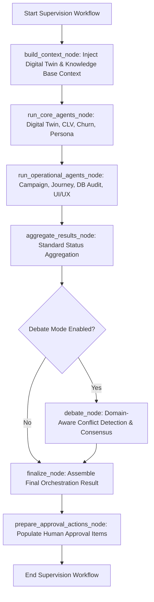

# OSMOS LangGraph Multi-Agent Supervision Layer (Phase 8.7)

## Overview
The **LangGraph Supervision Layer** (`agents/langgraph_supervision/`) provides stateful workflow orchestration for the OSMOS 8-agent Multi-Agent Supervision Layer.

LangGraph serves as the default workflow orchestration engine, wrapping existing deterministic agents inside modular, inspectable graph nodes while preserving fallback compatibility with the legacy `OrchestratorAgent`.

---

## Workflow Graph Topology

---

## Key Architectural Principles

1. **Existing Agents Preserved**: Deterministic analytical agents (`DigitalTwinAgent`, `CLVAgent`, `ChurnRiskAgent`, `PersonaAgent`, `CampaignAgent`, `JourneyAgent`, `DatabaseAuditAgent`, `UIUXAgent`) are not replaced; they are wrapped inside read-only graph nodes.
2. **Stateful Execution**: Graph state (`SupervisionState`) carries context, knowledge evidence, agent outputs, conflict reports, and consensus records across node boundaries.
3. **Domain-Aware Conflict Resolution**: Conflicts are evaluated per domain. `CLV Agent OK` vs `Churn Risk Critical` is resolved as valid CLV model computation alongside high churn risk, recommending low-cost automated retention.
4. **Read-Only Governance**: Graph nodes execute pure analytical checks with zero direct database mutations or automated campaign dispatches.
5. **Legacy Fallback**: The legacy `OrchestratorAgent` remains available as an automatic fallback engine if LangGraph is uninstalled or unconfigured.

---

## File Structure

- `supervision_state.py`: TypedDict state definition for graph execution context.
- `supervision_nodes.py`: Implementation of read-only graph execution nodes.
- `supervision_graph.py`: LangGraph graph construction, node wiring, conditional routing, and fallback wrapper.
