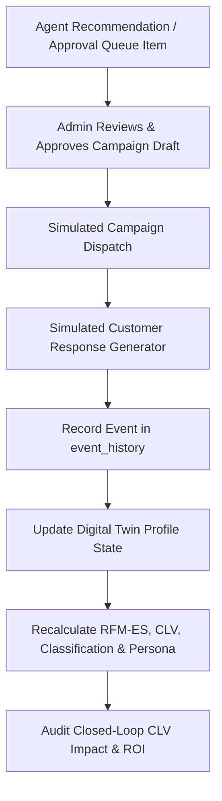

# OSMOS Closed-Loop Campaign Simulation Engine (Phases 7.0 - 8.7)

## Overview
The **Closed-Loop Campaign Simulation Engine** (`campaigns/`) transforms OSMOS from a passive analytical platform into an interactive, feedback-driven marketing simulation environment.

It allows administrators to convert **Agent Supervision Recommendations** and **Human Approval Queue Items** into structured campaign dispatches, simulate probabilistic customer behavioral responses (Opened, Clicked, Purchased, Complained, Unsubscribed), record time-series events in PostgreSQL, and evaluate Digital Twin state updates and CLV value lift in real time.

---

## Closed-Loop Simulation Flow

---

## Prototype Safety & Governance Rules

> [!IMPORTANT]  
> **PROTOTYPE SAFETY GUARANTEE**:
> - **ZERO REAL MESSAGES SENT**: The system does **not** send real emails, SMS, or external notifications.
> - **ZERO EXTERNAL MARKETING CONNECTIVITY**: No connections exist to SendGrid, Twilio, HubSpot, or external channels.
> - `simulate_dispatch()` updates status in PostgreSQL to `'Simulated Dispatch'` and sets `dispatched_at` timestamp.
> - **Human Approval Required**: Dispatches require explicit administrator approval before execution.

---

## Module Files

- `campaign_dispatcher.py`: Executes simulated dispatches, logging campaign metadata to `campaign_dispatches`.
- `campaign_response_simulator.py`: Generates probabilistic customer responses (or forced scenario responses) and logs events to `event_history`.
- `campaign_repository.py`: PostgreSQL persistence methods for dispatches, target filters, and responses.
- `campaign_dashboard.py`: User interface for campaign drafting, dispatch simulation, and closed-loop performance auditing.
