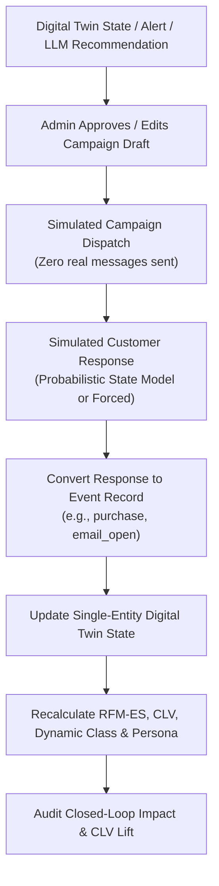

# OSMOS — Closed-Loop Campaign Simulation Engine (`campaigns/`)

## 1. Overview & Purpose

The **Closed-Loop Campaign Simulation Engine** (`campaigns/`) transforms OSMOS from a passive decision-support platform into an active, feedback-driven CRM intelligence ecosystem.

It allows administrators to convert **Local LLM Action Recommendations** and **Digital Twin State Advisories** into structured marketing campaign dispatches, simulate customer responses (Opened, Clicked, Purchased, Complained, etc.), convert those responses into time-series system events, update single-entity Digital Twin profiles, and evaluate campaign ROI and CLV value lift in real time.

---

## 2. Scientific Rationale

> **Scientific Core Concept**:
> The closed-loop layer allows OSMOS to move from passive decision support to simulated action-feedback learning. Recommendations generated from Digital Twin states and historical alerts can be transformed into marketing actions, simulated responses can be recorded as events, and the Digital Twin can be updated accordingly. This enables continuous monitoring of how marketing decisions influence customer value, risk, and segment evolution.

---

## 3. Prototype Safety & Dispatch Rules

> [!IMPORTANT]
> **PROTOTYPE SAFETY GUARANTEE**:
> - **NO REAL MESSAGES ARE SENT**: The system does NOT send real emails, SMS, or push notifications.
> - **ZERO EXTERNAL API CONNECTIVITY**: No connections exist to SendGrid, Twilio, HubSpot, Salesforce, or external marketing platforms.
> - `simulate_dispatch()` updates the status in PostgreSQL to `'Simulated Dispatch'` and sets the `dispatched_at` timestamp.

---

## 4. Component Structure

| Module File | Purpose & Responsibilities |
| :--- | :--- |
| **[`campaign_repository.py`](file:///D:/EMSI/PFA-Summer/campaigns/campaign_repository.py)** | PostgreSQL repository for `campaign_dispatches` and `campaign_responses` tables. |
| **[`campaign_dispatcher.py`](file:///D:/EMSI/PFA-Summer/campaigns/campaign_dispatcher.py)** | Draft creation, approval workflow, and simulated dispatch execution. |
| **[`campaign_simulator.py`](file:///D:/EMSI/PFA-Summer/campaigns/campaign_simulator.py)** | Probabilistic customer response simulator, event converter, and single-entity updater. |
| **[`campaign_metrics.py`](file:///D:/EMSI/PFA-Summer/campaigns/campaign_metrics.py)** | Response rate calculations, channel distributions, and CLV lift metrics. |
| **[`campaign_dashboard.py`](file:///D:/EMSI/PFA-Summer/campaigns/campaign_dashboard.py)** | Streamlit user interface for campaign management and impact analysis. |
| **[`test_campaigns.py`](file:///D:/EMSI/PFA-Summer/campaigns/test_campaigns.py)** | Unit test suite for dispatch, response simulation, and repository operations. |

---

## 5. Storage Mode Behavior

- **PostgreSQL Mode (`OSMOS_STORAGE_BACKEND=postgres`)**: Fully enabled. Campaign dispatches, customer responses, and event history are saved with full relational integrity and versioning.
- **Excel Fallback Mode**: Gracefully displays a message: *"Campaign simulation with dispatch tracking requires PostgreSQL."* The app remains 100% operational without crashing.

---

## 6. Limitations & Production Roadmap

- **Prototype Scope**: Response probabilities are generated mathematically using entity state feature weights (recency, engagement score, churn risk, complaints).
- **Future Integration (Phases 8 & 9)**: Production environments will replace `simulate_dispatch()` and `simulate_response()` with webhooks connected to SendGrid, Twilio, and CRM APIs for real customer response ingestion.
