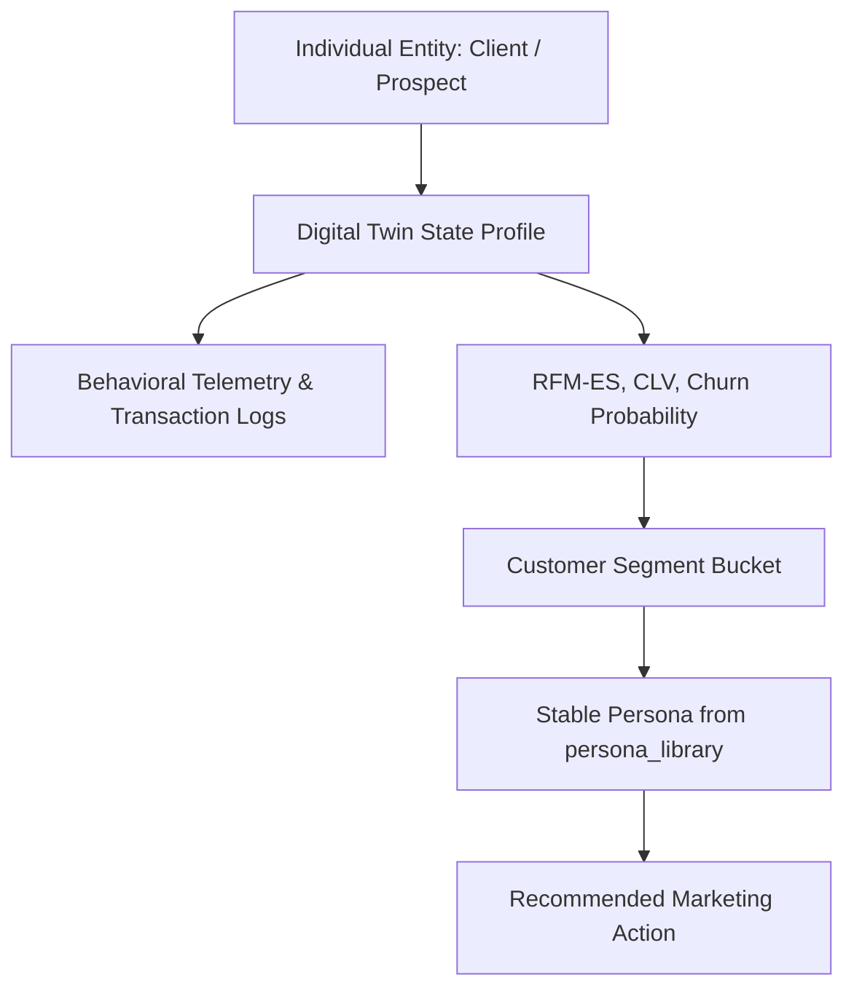

# OSMOS Digital Twin Modeling Layer (Phases 6.0 - 8.7)

## Overview
The **Digital Twin Modeling Layer** (`digital_twin/`) manages the individual-level virtual state of customer and prospect entities.

It captures core identity, real-time behavioral telemetry, multi-dimensional scores (RFM-ES, CLV, Churn Risk), model predictions, cohort segments, and stable personas into unified state representations backed by versioned PostgreSQL snapshot tables (`digital_twin_snapshots`).

---

## Resolution Hierarchy & Architecture

---

## Scientific Distinction: Digital Twin vs. Persona

- **Digital Twin**: Belongs strictly to **one individual entity** (e.g. `C00001` or `P_DEMO_001`). It is dynamic, real-time, and continuously updated as new events are logged to `event_history`.
- **Persona**: Belongs to a **customer segment** (e.g. `High-Value Loyalists`). It is a strategic marketing abstraction representing collective behavioral traits, risk profiles, and communication guidelines.

---

## Module Files

- `digital_twin_builder.py`: Aggregates identity, behavioral metrics, predictive scores, segment assignments, and persona blueprints into a unified Digital Twin payload.
- `digital_twin_explainer.py`: Provides deterministic rule-based explainers and button-triggered local LLM summaries.
- `digital_twin_dashboard.py`: Streamlit interface for exploring Digital Twin profiles, historical timelines, and state evolution metrics.
