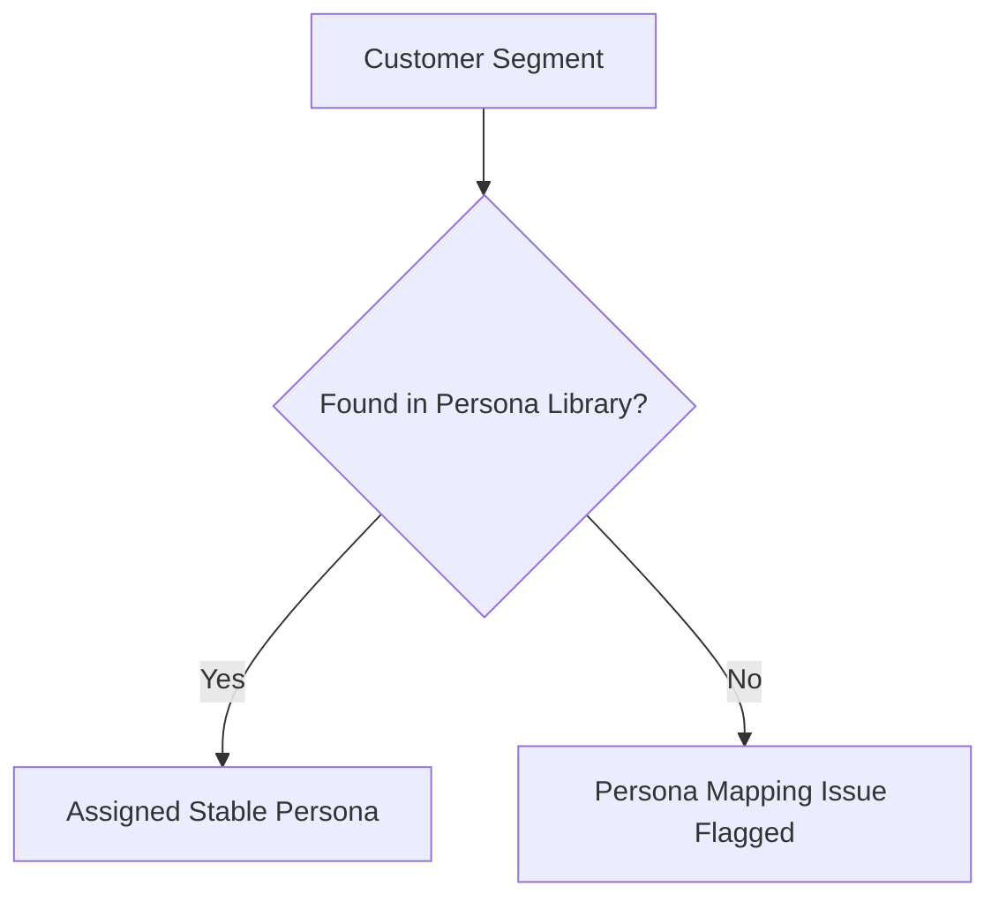
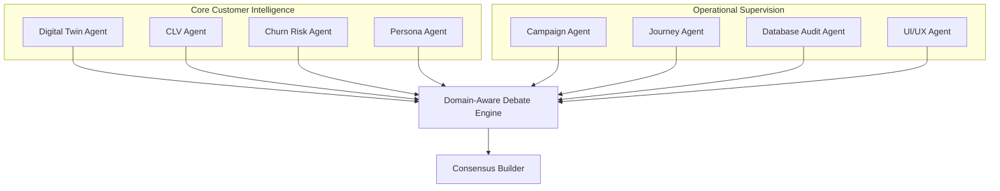

# OSMOS AI & Supervision Modules Specification

This document provides a detailed technical reference for all artificial intelligence, machine learning, multi-agent supervision, knowledge memory, and simulation modules in **OSMOS** (Omnichannel Supervised Marketing Optimization System).

---

## 1. Predictive Machine Learning Suite

OSMOS integrates three primary analytical models:

1. **RFM-ES Score Engine (`analytics/rfm_es_calculator.py`)**: Computes 5-dimension normalized engagement and satisfaction scores combining Recency, Frequency, Monetary spend, Engagement intensity, and Satisfaction ratings.
2. **Customer Lifecycle Classification Model (`models/`)**: Multi-class classification model assigning entities to standard lifecycle cohorts:
   - Cold Prospect
   - Warm Prospect
   - Active Client
   - VIP Client
   - Churn Risk Client
3. **CLV Forecasting Engine (`analytics/clv_calculator.py`)**: Predicts customer lifetime value monetary amount (MAD) and value score based on purchase velocity, average basket size, and dropout probability.

---

## 2. Segment-First Persona Resolution Module

The **Persona Library** (`personas/`) enforces deterministic mapping from quantitative customer segments to official stable business personas.

### Official Business Mappings:
- **Prospect** -> `New Explorer`
- **New Customers** -> `New Explorer`
- **High-Value Loyalists** -> `Premium Loyalist`
- **At-Risk Premium Clients** -> `Silent VIP at Risk`
- **Complaint-Driven Risk Clients** -> `Frustrated Client`
- **Dormant Low-Value Clients** -> `Sleeping Client`
- **Social Advocates** -> `Brand Advocate`
- **Standard Active Clients** -> `Regular Buyer`

---

## 3. LangGraph Multi-Agent Supervision Layer

The multi-agent supervision framework (`agents/`) coordinates 8 specialized agents via **LangGraph**:

### Debate Engine Domain Logic:
- Disagreements are computed strictly within domain groups (`Customer Intelligence` vs `Operational Supervision`).
- `CLV Agent OK` signifies calculation validity, not customer health; `CLV OK` vs `Churn Critical` is not treated as a domain status conflict.
- Low CLV + High Churn is resolved as: *"Retention action should be cost-efficient because churn risk is high but CLV is low."*
- Database Audit Warning with 0 orphaned references is treated as a *"demo readiness / initialization warning"*.

---

## 4. Local Ollama LLM & Action Intelligence

OSMOS integrates a local **Ollama (Qwen3:8B)** LLM client (`llm/`) for advisory language generation:

### Governance & Safety Controls:
- **Button-Triggered Only**: Zero background or automated calls on page load or data fetch.
- **Copywriting Assistance Only**: The LLM is an advisory language layer, not the controller of workflow or database state.
- **Deterministic Blueprint Protection**: LLM text generation is bounded by deterministic blueprints to prevent structural or offer mutation.
- **Local Privacy**: Runs entirely on local infrastructure with zero external cloud API transmissions.

---

## 5. A/B Test & Digital Twin Response Simulator

The **A/B Test Simulator** (`ab_testing/`) allows an administrator to formulate business questions, define or generate campaign variants, simulate behavioral reactions, and evaluate winning strategies.

### Core Workflow Capabilities:
- Select a customer or prospect entity and inspect their current Digital Twin profile.
- Formulate a strategic business question and select an objective (`retention`, `conversion`, `upsell`, `reactivation`, `complaint_recovery`, `engagement`).
- Choose a target channel (`email`, `sms`, `phone`, `web_notification`, `simulated_only`).
- Select variant count (`A/B` [2 variants] or `A/B/C` [3 variants]).
- Generate or manually edit campaign variants.
- Execute Digital Twin behavioral response simulation across all active variants.
- Evaluate variant metrics, calculate composite response scores ($0-100$), and rank strategies.
- Convert the winning strategy into a campaign draft or apply the simulated response as a historical event upon human approval.

### Role of the LLM vs. Deterministic System:
The LLM is strictly a copywriting assistant, not the controller of the experiment structure.

- **Deterministic System Controls**: Variant count, variant labels (`A`, `B`, `C`), offer types, incentive values, allowed tones, channel, validation rules, simulation logic, and final ranking.
- **LLM Enriches**: Variant title, message text, tone wording, and call to action.

### Deterministic Variant Blueprints:
To protect against unstable or incomplete LLM generation, OSMOS constructs deterministic skeletons before LLM synthesis:
- **A/B Tests**:
  - Variant A = Service recovery / apology / priority support resolution
  - Variant B = Discount / goodwill credit / commercial incentive
- **A/B/C Tests**:
  - Variant A = Service recovery
  - Variant B = Discount or goodwill credit
  - Variant C = Hybrid, reactivation, specialist review, loyalty reassurance, or contextual alternative based on objective and persona

### LLM Failure Handling & Fallback Strategy:
Fallback to deterministic blueprints is expected and safe, ensuring system stability if local LLM inference fails or outputs partial text. Status codes include `llm_success_valid`, `local_llm_offline`, `timeout`, `empty_llm_output`, `invalid_json`, `partial_json`, `empty_variants`, `incomplete_variant_count`, `semantic_validation_failed`, and `fallback_used`.

### Streamlit Session State Synchronization:
Generated or fallback variant fields (`variant_title`, `message_text`, `offer_type`, `incentive_value`, `tone`, `call_to_action`) are explicitly synchronized into standardized widget keys (`f"ab_variant_{label}_*"`). Simulation reads directly from active visible widget state using `collect_variants_from_widget_state()`.

---

## 6. RAG Knowledge Base & Decision Memory

The **Knowledge Base** (`knowledge/`) implements document chunking and keyword/vector search:
- **Persistence**: PostgreSQL tables `knowledge_documents` and `knowledge_chunks`.
- **Indexing**: Extracts passages from system specifications, governance policies, and approval logs.
- **Retrieval**: Injects prior decision context into multi-agent supervision reviews.

---

## 7. Executive Report Generator

The **Executive Report Generator** (`reports/`) synthesizes entity states, agent outputs, debate consensus, and RAG evidence into executive reports:
- Supported formats: **Markdown**, **HTML**, standalone **PDF**.
- Supported report types: Entity Executive Report, Agent Run Report, Journey Report, System Overview Report.
