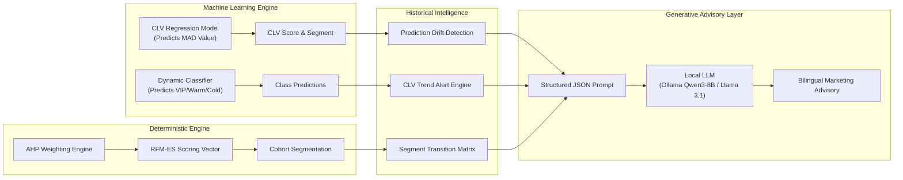

# OSMOS — AI & Machine Learning Component Architecture

## 1. AI/ML Component Portfolio

OSMOS incorporates a hybrid AI architecture combining deterministic mathematical scoring, supervised machine learning, time-series statistical modeling, and generative local LLM advice.

---

## 2. Core AI Component Specifications

### A. RFM-ES Scoring Vector (AHP-Weighted)

- **Inputs**: Recency (days), 30-day Visits, 30-day Product Views, 90-day Purchases, 90-day Total Spend, Email Open Rate, Complaint Count, Social Sentiment.
- **Methodology**: Analytical Hierarchy Process (AHP) pairwise matrix weighting.
- **Output**: Normalized scalar score $S_{\text{RFM-ES}} \in [0.0, 1.0]$.

### B. Customer Lifetime Value (CLV) Regression Model

- **Inputs**: Behavioral history, average order value, purchase frequency, engagement metrics.
- **Output**: Predicted 12-month value in Moroccan Dirhams (MAD) and normalized CLV score (0–100).

### C. Dynamic Classification Model

- **Target Classes**: *VIP Client*, *Regular Client*, *At-Risk Client*, *Warm Prospect*, *Cold Prospect*.
- **Output**: Multi-class classification probability distribution.

### D. Advanced Historical Intelligence & Drift Detection

- **CLV Trend Alerts**: Identifies entities experiencing sudden CLV drops ($> 15\%$) or growth over consecutive snapshot periods.
- **Segment Transition Matrix**: Computes Markov transition probabilities across customer segments.
- **Prediction Drift Monitoring**: Evaluates distribution shifts between baseline predictions and current window predictions using Population Stability Index (PSI) concepts.

---

## 3. Strict Guardrails & LLM Role Boundary

> [!IMPORTANT]
> **Deterministic vs. Generative Separation**
>
> - The **Local LLM does NOT calculate** CLV amounts, RFM scores, churn risks, or alert thresholds.
> - All numeric predictions and alert triggers are computed **100% deterministically** by python ML modules.
> - The LLM is used **strictly for natural language synthesis**, explaining alerts, drafting customer messages, and suggesting tactical actions upon explicit admin button clicks.
