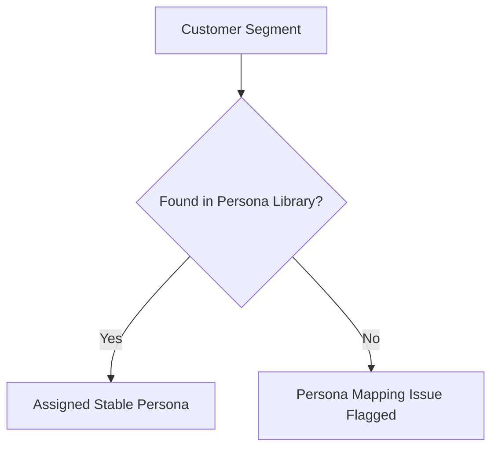
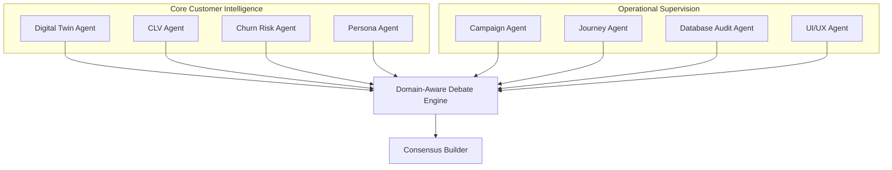

# OSMOS AI & Supervision Modules Specification

This document provides a detailed technical reference for all artificial intelligence, machine learning, multi-agent supervision, and knowledge memory modules in **OSMOS**.

---

## 1. Predictive Machine Learning Suite

OSMOS integrates three primary analytical models:

1. **RFM-ES Score Engine (`analytics/rfm_es_calculator.py`)**: Computes 5-dimension normalized engagement and satisfaction scores combining Recency, Frequency, Monetary spend, Engagement intensity, and Satisfaction ratings.
2. **Customer Lifecycle Classification Model (`models/`)**: Multi-class classification model assigning entities to standard lifecycle cohorts:
   - Cold Prospect
   - Warm Prospect
   - Active Client
   - VIP Client
   - Churn Risk Client
3. **CLV Forecasting Engine (`analytics/clv_calculator.py`)**: Predicts customer lifetime value monetary amount (MAD) and value score based on purchase velocity, average basket size, and dropout probability.

---

## 2. Segment-First Persona Resolution Module

The **Persona Library** (`personas/`) enforces deterministic mapping from quantitative customer segments to official stable business personas.

### Official Business Mappings:
- **Prospect** $\rightarrow$ `New Explorer`
- **New Customers** $\rightarrow$ `New Explorer`
- **High-Value Loyalists** $\rightarrow$ `Premium Loyalist`
- **At-Risk Premium Clients** $\rightarrow$ `Silent VIP at Risk`
- **Complaint-Driven Risk Clients** $\rightarrow$ `Frustrated Client`
- **Dormant Low-Value Clients** $\rightarrow$ `Sleeping Client`
- **Social Advocates** $\rightarrow$ `Brand Advocate`
- **Standard Active Clients** $\rightarrow$ `Regular Buyer`

---

## 3. LangGraph Multi-Agent Supervision Layer

The multi-agent supervision framework (`agents/`) coordinates 8 specialized agents via **LangGraph**:

### Debate Engine Domain Logic:
- Disagreements are computed strictly within domain groups (`Customer Intelligence` vs `Operational Supervision`).
- `CLV Agent OK` signifies calculation validity, not customer health; `CLV OK` vs `Churn Critical` is not treated as a domain status conflict.
- Low CLV + High Churn is resolved as: *"Retention action should be cost-efficient because churn risk is high but CLV is low."*
- Database Audit Warning with 0 orphaned references is treated as a *"demo readiness / initialization warning"*.

---

## 4. Local Ollama LLM & Action Intelligence

OSMOS integrates a local **Ollama (Qwen)** LLM client (`llm/`) for advisory language generation:

### Governance & Safety Controls:
- **Button-Triggered Only**: Zero background or automated calls on page load or data fetch.
- **Advisory Role**: LLM outputs do not write database records or execute real campaign dispatches.
- **Deterministic Validation**: Structured outputs (such as LLM Journey Plans) undergo strict JSON repair and rule validation before administrator review.
- **Local Privacy**: Runs entirely on local infrastructure with zero external API calls.

---

## 5. RAG Knowledge Base & Decision Memory

The **Knowledge Base** (`knowledge/`) implements document chunking and vector/keyword search:
- **Persistence**: Tables `knowledge_documents` and `knowledge_chunks`.
- **Indexing**: Extracts passages from project documentation, governance rules, and approval logs.
- **Retrieval**: Injects relevant prior decision context into multi-agent supervision reviews.

---

## 6. Executive Report Generator

The **Executive Report Generator** (`reports/`) synthesizes entity states, agent outputs, debate consensus, and RAG evidence into comprehensive reports:
- Supported formats: **Markdown**, **HTML**, standalone **PDF**.
- Supported report types: Entity Executive Report, Agent Run Report, Journey Report, System Overview Report.
