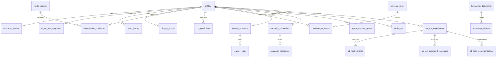

# OSMOS API & Database Schema Data Dictionary

This document provides a detailed data dictionary for all 20 PostgreSQL relational tables maintained within **OSMOS**.

---

## Relational Entity-Relationship Diagram

---

## Detailed Data Dictionary

### 1. `entities`
Primary master table storing client and prospect identity records.
- `entity_id` (VARCHAR(50), Primary Key): Unique entity identifier (e.g. `C00001`, `P_DEMO_001`).
- `entity_type` (VARCHAR(20), CHECK IN ('Client', 'Prospect')): Current entity status.
- `original_entity_type` (VARCHAR(20)): Initial entity status at intake.
- `created_at` / `converted_at`: ISO timestamp strings for creation and conversion events.
- `region`, `source_channel`, `segment`, `persona`: Demographic attributes.
- `price_sensitivity`, `income_power_score`, `initial_interest_score`, `basic_profile_score`: Normalized behavioral affinity parameters ($0.0 - 1.0$).

### 2. `customer_profiles`
Demographic profile table containing customer demographic data (PII).
- `entity_id` (VARCHAR(50), FK -> `entities.entity_id`): Foreign key link.
- `age`, `sex`, `email`, `phone_number`, `company_name`, `job_title`, `city`, `address`: Contact attributes.

### 3. `digital_twin_snapshots`
Real-time state snapshot table storing 30-day/90-day aggregated metrics.
- `entity_id` (VARCHAR(50), Primary Key): Foreign key link.
- `recency_days`, `visits_30d`, `product_views_30d`, `cart_additions_30d`, `purchases_90d`: Engagement metrics.
- `total_spent_90d_mad`, `avg_order_value_mad`: Monetary spend variables.
- `email_open_rate`, `email_click_rate`, `complaint_count_90d`, `review_score_avg`: Satisfaction and risk variables.
- `conversion_probability`, `churn_risk_score`, `rfm_score`: Multi-dimensional score outputs.

### 4. `event_history`
Complete operational event log recording interaction and purchase transactions.
- `event_id` (VARCHAR(50), Primary Key): Unique event identifier.
- `entity_id` (VARCHAR(50), FK -> `entities.entity_id`): Entity link.
- `event_type` (VARCHAR(100)): Event type (`purchase`, `page_visit`, `complaint`, `email_open`, etc.).
- `event_date` (TIMESTAMP WITH TIME ZONE): Transaction timestamp.
- `old_class`, `new_class`, `class_changed`: Lifecycle cohort state change flags.
- `before_values`, `after_values` (JSONB): Pre- and post-event state snapshot JSONs.

### 5. `rfm_es_scores`
Versioned historical table tracking RFM-ES calculation results over time.
- `entity_id` (VARCHAR(50), FK -> `entities.entity_id`): Entity link.
- `event_id` (VARCHAR(50), FK -> `event_history.event_id`): Triggering event link.
- `R_raw`, `F_raw`, `M_raw`, `E_raw`, `S_raw`: Raw unscaled dimension values.
- `rfm_score_raw_1_to_5`: Scale 1 to 5 score representation.
- `rfm_score`: Min-max normalized composite score ($0.0 - 1.0$).
- `ahp_weight_R`, `ahp_weight_F`, `ahp_weight_M`, `ahp_weight_E`, `ahp_weight_S`: AHP dimension weights.

### 6. `classification_predictions`
Versioned history of customer lifecycle classification model predictions.
- `entity_id`, `event_id`: Relational links.
- `dynamic_class`: Predicted lifecycle cohort (`Cold Prospect`, `Warm Prospect`, `Active Client`, `VIP Client`, `Churn Risk Client`).
- `confidence`: Model confidence probability.
- `top_3_probs` (JSONB): Top-3 class probability distribution.
- `model_name`, `model_version`, `model_registry_id`: Lineage tracking metadata.

### 7. `clv_predictions`
Customer Lifetime Value monetary forecasts and value score parameters.
- `entity_id`, `event_id`: Relational links.
- `predicted_clv_amount_mad`: Forecasted monetary CLV amount in Moroccan Dirhams (MAD).
- `predicted_clv_score`: Normalized CLV score ($0.0 - 1.0$).
- `predicted_clv_segment`: Value tier (`High Value`, `Medium Value`, `Low Value`).
- `clv_method_used`: Algorithm used (`Pareto/NBD-Gamma`, `Hybrid ML-Math`).

### 8. `customer_segments`
Versioned customer segment and stable persona assignment log.
- `entity_id`, `event_id`: Relational links.
- `customer_segment`: Assigned quantitative segment name.
- `customer_persona`: Resolved stable business persona from `persona_library`.
- `segmentation_method`: Assignment rule engine method.

### 9. `persona_library`
Catalog table defining official stable personas and business action blueprints.
- `segment_name` (TEXT, Unique Key): Segment lookup key.
- `persona_name` (TEXT): Official persona label.
- `description_fr`, `description_en`: Bilingual persona overview text.
- `behavior_profile_fr`, `value_profile_fr`, `risk_profile_fr`, `recommended_action_fr`: Strategic guidance blueprints.

### 10. `journey_scenarios` & `journey_steps`
Digital Twin lifecycle simulation scenario headers and step-by-step stage transition logs.
- `scenario_id`, `scenario_name`, `status`: Scenario execution headers.
- `step_id`, `step_order`, `stage_name`: Stage ordering attributes.
- `trigger_event_id` (FK -> `event_history.event_id`): Triggering event reference.
- `before_dynamic_class`, `after_dynamic_class`, `before_clv_amount`, `after_clv_amount`: Stage state delta metrics.

### 11. `campaign_dispatches` & `campaign_responses`
Closed-loop marketing campaign dispatch headers and customer behavioral responses.
- `campaign_id`, `campaign_type`, `campaign_channel`, `status`: Campaign dispatch attributes.
- `response_type` (`Opened`, `Clicked`, `Purchased`, `Complained`, `Unsubscribed`): Behavioral response type.
- `response_event_id` (FK -> `event_history.event_id`): Linked event history row.

### 12. `agent_runs`, `agent_outputs`, `agent_approval_queue`
Multi-agent supervision execution logs, individual agent reports, and human approval queue items.
- `run_id`, `global_status`, `recommended_next_best_action`: Global supervision run summary.
- `agent_id`, `status`, `observations`, `risks`, `opportunities`, `evidence`: Per-agent audit outputs.
- `approval_id`, `proposed_action_title`, `status` (`Pending`, `Approved`, `Rejected`, `Converted to Campaign Draft`): Human-in-the-loop approval item.

### 13. `knowledge_documents` & `knowledge_chunks`
RAG Knowledge Base header documents and chunked text passages.
- `document_id`, `source_type`, `source_name`, `title`: Document headers.
- `chunk_id`, `chunk_text`, `keywords`: Text chunk search records.

### 14. `audit_logs` & `model_registry`
System operational audit trails and trained machine learning model metadata registry.
- `action_type`, `details` (JSONB): Audit trail log.
- `model_type`, `model_name`, `artifact_path`, `metrics` (JSONB): Trained model lineage tracking.

### 15. `ab_test_experiments`
Stores experiment metadata, target entity, business question, objective, channel, variant count, status, and creation timestamps.
- `experiment_id` (SERIAL, Primary Key): Unique experiment identifier.
- `entity_id` (VARCHAR(50), FK -> `entities.entity_id`): Target customer/prospect entity ID.
- `experiment_name` (VARCHAR(255)): Descriptive experiment title.
- `admin_question` (TEXT): Business hypothesis or question posed by the administrator.
- `objective` (VARCHAR(50)): Strategic objective (`retention`, `conversion`, `upsell`, `reactivation`, `complaint_recovery`, `engagement`).
- `target_segment` (VARCHAR(100)): Target customer segment at time of test formulation.
- `target_persona` (VARCHAR(100)): Target customer persona at time of test formulation.
- `status` (VARCHAR(50)): Experiment state (`Simulated`, `Converted to Draft`, `Event Applied`).
- `llm_generated` (BOOLEAN): Flag indicating whether variant copy was synthesized via local LLM.
- `created_at` (TIMESTAMP WITH TIME ZONE): Experiment setup timestamp.

### 16. `ab_test_variants`
Stores variant definitions including variant label, title, message text, offer type, incentive value, tone, channel, call to action, and deterministic validation status.
- `variant_id` (SERIAL, Primary Key): Unique variant record identifier.
- `experiment_id` (INTEGER, FK -> `ab_test_experiments.experiment_id`): Parent experiment link.
- `variant_label` (VARCHAR(10)): Variant label (`A`, `B`, or `C`).
- `variant_title` (VARCHAR(255)): Short title for the variant.
- `message_text` (TEXT): Customer-facing copy text.
- `offer_type` (VARCHAR(50)): Offer classification (`none`, `service_recovery`, `discount`, `goodwill_credit`, `reactivation`, `vip_perk`, `hybrid`).
- `incentive_value` (NUMERIC(10,2)): Numerical financial incentive value (e.g. percentage or fixed credit).
- `channel` (VARCHAR(50)): Communication channel (`email`, `sms`, `phone`, `web_notification`, `simulated_only`).
- `tone` (VARCHAR(50)): Strategic tone (`empathetic`, `commercial`, `informational`, `exclusive`, `reassuring`).
- `call_to_action` (VARCHAR(100)): Action button/link text.
- `expected_behavior` (TEXT): Hypothesized behavioral reaction.
- `is_valid` (BOOLEAN): Result of deterministic rule validation check.
- `validation_warnings` (JSONB): Array of rule validation warnings or notes.
- `created_at` (TIMESTAMP WITH TIME ZONE): Creation timestamp.

### 17. `ab_test_simulated_responses`
Stores simulated Digital Twin behavioral response metrics and composite scores for each variant.
- `response_id` (SERIAL, Primary Key): Unique response record identifier.
- `experiment_id` (INTEGER, FK -> `ab_test_experiments.experiment_id`): Parent experiment link.
- `variant_id` (INTEGER, FK -> `ab_test_variants.variant_id`): Linked variant identifier.
- `variant_label` (VARCHAR(10)): Variant label (`A`, `B`, or `C`).
- `simulated_response_type` (VARCHAR(50)): Modeled outcome (`Opened`, `Clicked`, `Converted`, `Complained`, `Ignored`).
- `predicted_open_probability` (NUMERIC(5,4)): Estimated open probability ($0.0 - 1.0$).
- `predicted_click_probability` (NUMERIC(5,4)): Estimated click probability ($0.0 - 1.0$).
- `predicted_conversion_probability` (NUMERIC(5,4)): Estimated conversion probability ($0.0 - 1.0$).
- `predicted_complaint_probability` (NUMERIC(5,4)): Estimated complaint probability ($0.0 - 1.0$).
- `predicted_churn_delta` (NUMERIC(5,4)): Estimated churn risk score change.
- `predicted_clv_delta` (NUMERIC(12,2)): Estimated monetary CLV lift in MAD.
- `predicted_rfm_delta` (NUMERIC(5,4)): Estimated RFM composite score change.
- `predicted_satisfaction_delta` (NUMERIC(5,4)): Estimated satisfaction rating change.
- `response_score` (NUMERIC(5,2)): Composite evaluation score ($0 - 100$).
- `created_at` (TIMESTAMP WITH TIME ZONE): Simulation timestamp.

### 18. `ab_test_recommendations`
Stores executive decision recommendations, winning variant selection, confidence scores, decision reasons, and risk notes.
- `recommendation_id` (SERIAL, Primary Key): Unique recommendation record identifier.
- `experiment_id` (INTEGER, FK -> `ab_test_experiments.experiment_id`): Parent experiment link.
- `winning_variant_id` (INTEGER, FK -> `ab_test_variants.variant_id`): Winning variant identifier.
- `winning_variant_label` (VARCHAR(10)): Label of recommended variant (`A`, `B`, or `C`).
- `confidence_score` (NUMERIC(5,4)): Algorithmic confidence probability ($0.0 - 1.0$).
- `recommendation_summary` (TEXT): Executive summary of the winning strategy.
- `decision_reason` (TEXT): Analytical justification explaining why this variant won.
- `risk_notes` (TEXT): Risk assessment notes and operational caveats.
- `created_at` (TIMESTAMP WITH TIME ZONE): Recommendation timestamp.
