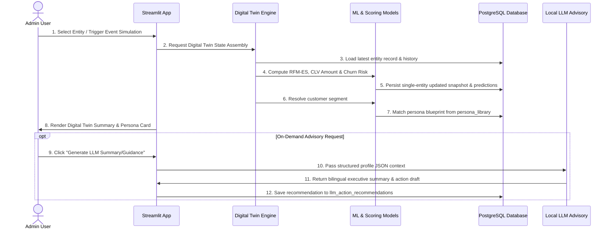

# OSMOS — Data Flow & Lifecycle Operations

## 1. End-to-End Data Processing Pipeline

The OSMOS lifecycle follows a strict, event-driven data flow across ingestion, feature vectorization, scoring, persistence, resolution, and LLM advisory.

---

## 2. Step-by-Step Lifecycle Description

1. **Entity Selection / Event Trigger**:

   - Admin selects an entity (`entity_id`) or executes a simulation action (e.g., *Record Purchase*, *Submit Complaint*, *Convert Prospect to Client*).
2. **Single-Entity State Reconstruction**:

   - OSMOS fetches the target entity snapshot. To maintain sub-second performance (< 1s), only the single affected entity row is mutated and saved.
3. **Predictive Vectorization**:

   - Machine learning algorithms compute:
     - **RFM-ES**: Recency, Frequency, Monetary, Engagement, Sentiment weighted vector.
     - **CLV Regression**: Predicted 12-month Customer Lifetime Value in Moroccan Dirhams (MAD).
     - **Dynamic Classification**: Assignment to dynamic class (e.g., *VIP Client*, *Warm Prospect*).
4. **Segment-First Persona Resolution**:

   - The computed features determine the entity's **Customer Segment**.
   - The resolved segment queries the `persona_library` table to retrieve the associated **Persona Blueprint**.
5. **Historical Persistence**:

   - Updated snapshots and predictions are appended to PostgreSQL historical versioning tables (`clv_predictions`, `classification_predictions`, `customer_segments`, `event_history`).
6. **Button-Triggered LLM Assistance**:

   - If requested by the admin, the application formats the deterministic features into a JSON prompt payload sent to the local Ollama LLM.
   - The response is parsed, rendered as bilingual text (FR/EN), and persisted in `llm_action_recommendations`.
