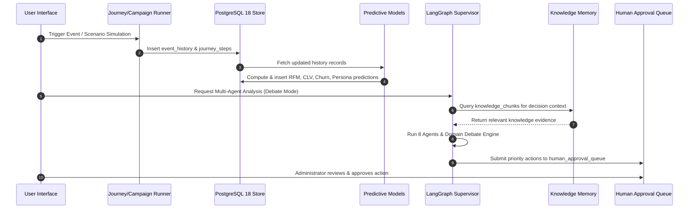
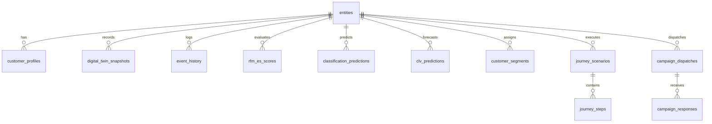
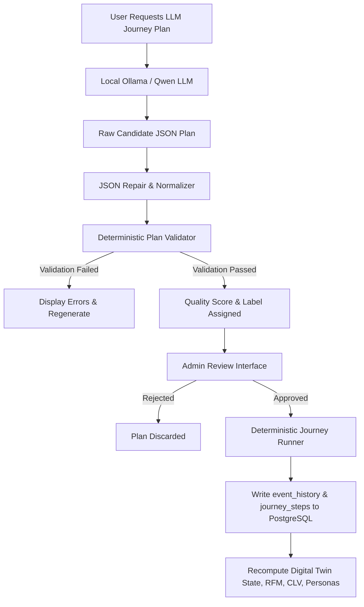

# OSMOS Data Flow Architecture Specification

This document details the end-to-end data pipeline, state persistence sequence, multi-agent supervision flow, and LLM journey scenario generation workflow within **OSMOS**.

---

## 1. End-to-End Operational Data Pipeline

Data flows through OSMOS in a closed-loop sequence, ensuring complete auditability and zero unverified database mutations.

---

## 2. PostgreSQL Persistence Architecture

All analytical calculations write permanent records to PostgreSQL 18 tables:

---

## 3. LLM Journey Scenario Planner Data Flow

The LLM-assisted Journey Planner uses a deterministic verification pipeline where candidate plans generated by local LLMs cannot alter database state directly.

---

## 4. RAG Knowledge Base Retrieval Flow

When running multi-agent supervision with Knowledge Memory enabled:

1. **Context Extraction**: Current entity state, segment, and churn status are formatted into a retrieval query.
2. **Chunk Search**: `KnowledgeRetriever` searches indexed documentation passages in `knowledge_chunks`.
3. **Context Injection**: Relevant guidelines are injected into the agent evaluation payload.
4. **Traceable Evidence**: Injected guidelines are attached to agent outputs as evidence items for human review.
