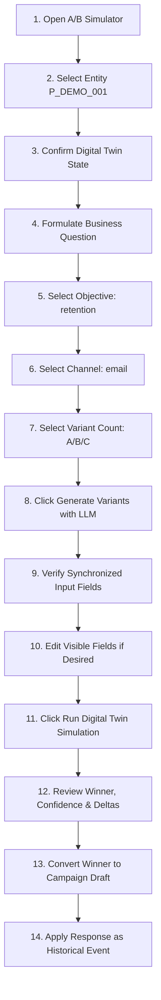

# OSMOS Executive Demo & Presentation Guide

This document provides a step-by-step presentation protocol for showcasing **OSMOS** to executive stakeholders, business managers, and technical auditors.

---

## Presentation Warning

> [!CAUTION]  
> **Demo Readiness Requirement**: Do **not** use demo entity `P_DEMO_001` in an executive presentation before verifying that its **Demo Entity Readiness Status** is **Ready for presentation** or **Partially ready** (with clear explanatory context). Uninitialized demo entities with 0 logged events will trigger operational readiness warnings during multi-agent supervision.

---

## 1. End-to-End Multi-Agent Supervision Protocol

Follow this 10-step protocol for showcasing multi-agent supervision and decision synthesis:

1. **Start Platform Application**: Launch Streamlit interface (`streamlit run app.py`). Verify active storage backend status (PostgreSQL active).
2. **Open Journey Simulator Page**: Navigate to the **Digital Twin Journey Tree Simulator** page in the left navigation panel.
3. **Prepare Full Demo Entity**: Click **"Prepare Full Demo Entity (P_DEMO_001)"** to seed full 5-stage lifecycle history records.
4. **Generate LLM Journey Plan**: Click **"Generate LLM Scenario Plan"** to demonstrate local AI scenario planning.
5. **Validate & Approve LLM Plan**: Observe the deterministic validator score card (`Quality: Excellent, Score: 100/100`). Click **"Approve & Save Journey Plan"**.
6. **Apply Journey Plan**: Click **"Apply Scenario to P_DEMO_001"** to execute deterministic stage progression and write PostgreSQL records.
7. **Open Agent Supervision Center**: Navigate to **Agent Supervision Center** in the navigation sidebar.
8. **Select LangGraph Workflow Engine**: In the workflow settings, select **LangGraph Stateful Graph Workflow** as the orchestration engine.
9. **Enable Domain Debate Mode & Memory**: Check **"Include Knowledge Base & Memory"** and **"Enable Agent Collaboration & Debate Mode"**.
10. **Run Multi-Agent Analysis**: Select entity `P_DEMO_001` and click **"Run Multi-Agent Analysis"**. Review cross-agent statement comparison, conflict detector findings, and synthesized consensus.

---

## 2. A/B Test & Digital Twin Response Simulator Protocol

Follow this 14-step protocol to demonstrate hypothesis formulation, LLM copywriting assistance, variant blueprint merging, Digital Twin behavioral simulation, and human governance:

### Detailed Demonstration Steps:

1. **Open A/B Test Simulator**: Navigate to the **A/B Test Simulator** page in the Streamlit navigation panel.
2. **Select Target Entity**: Choose customer entity `P_DEMO_001` from the entity dropdown selector.
3. **Confirm Digital Twin State**: Review the overview card confirming segment (`Complaint-Driven Risk Clients`) and persona (`Frustrated Client`).
4. **Formulate Business Question**: Enter or select the administrative question: *"Should we use a discount or a service recovery apology?"*
5. **Select Strategic Objective**: Choose `retention` as the strategic goal.
6. **Select Channel**: Select `email` as the target delivery medium.
7. **Select Variant Count**: Toggle **"Number of Variants"** to `A/B/C (3 Variants)`.
8. **Generate Campaign Variants**: Click **"Generate A/B Variants with LLM"**. Note the local LLM synthesis or blueprint fallback execution.
9. **Verify Field Synchronization**: Observe that all input fields for Variant A, Variant B, and Variant C (Title, Message Text, Offer Type, Incentive Value, Tone, CTA) are fully populated in the UI.
10. **Edit Visible Fields**: Modify any text string or selectbox value directly in the visible input widgets to demonstrate administrator control.
11. **Run Response Simulation**: Click **"Run Digital Twin Response Simulation"**.
12. **Review Simulation Outcome**: Inspect the winning variant banner (e.g. Variant A - Service Recovery), confidence score (e.g. 92%), metric deltas (open %, click %, churn reduction, CLV lift), and analytical decision reason.
13. **Convert Winner to Draft**: Click **"Convert Winner to Campaign Draft"** after administrative review.
14. **Apply Event**: Click **"Apply Response as Event (Admin Approved)"** to log the simulated customer response into the historical event ledger upon explicit approval.
