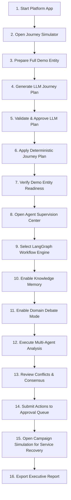

# OSMOS Executive Demo & Presentation Guide

This document provides a step-by-step presentation protocol for showcasing **OSMOS** to executive stakeholders, business managers, and technical auditors.

---

## Important Presentation Warning

> [!CAUTION]  
> **Demo Readiness Requirement**: Do **not** use demo entity `P_DEMO_001` in an executive presentation before verifying that its **Demo Entity Readiness Status** is **Ready for presentation** or **Partially ready** (with clear explanatory context). Uninitialized demo entities with 0 logged events will trigger operational readiness warnings during multi-agent supervision.

---

## End-to-End Executive Demonstration Protocol

Follow this 16-step protocol for an optimal demonstration:

### Detailed Walkthrough Instructions:

1. **Start Platform Application**: Launch Streamlit interface (`streamlit run app.py`). Verify active storage backend status (PostgreSQL active).
2. **Open Journey Simulator Page**: Navigate to the **Digital Twin Journey Tree Simulator** page in the left navigation panel.
3. **Prepare Full Demo Entity**: Click **"🚀 Prepare Full Demo Entity (P_DEMO_001)"** to seed full 5-stage lifecycle history records.
4. **Generate LLM Journey Plan (Optional)**: Click **"🤖 Generate LLM Scenario Plan"** to demonstrate local AI scenario planning.
5. **Validate & Approve LLM Plan**: Observe the deterministic validator score card (`Quality: Excellent, Score: 100/100`). Click **"✅ Approve & Save Journey Plan"**.
6. **Apply Journey Plan**: Click **"⚡ Apply Scenario to P_DEMO_001"** to execute deterministic stage progression and write PostgreSQL records.
7. **Check Demo Entity Readiness**: Verify the readiness banner displays `Ready for presentation (Readiness Score: 100/100)`.
8. **Open Agent Supervision Center**: Navigate to **Agent Supervision Center** in the navigation sidebar.
9. **Select LangGraph Workflow Engine**: In the workflow settings, select **LangGraph Stateful Graph Workflow** as the orchestration engine.
10. **Enable Knowledge Memory**: Check **"Include Knowledge Base & Memory"** to activate RAG context retrieval.
11. **Enable Domain Debate Mode**: Check **"Enable Agent Collaboration & Debate Mode"**.
12. **Run Multi-Agent Analysis**: Select entity `P_DEMO_001` and click **"Run Multi-Agent Analysis"**.
13. **Review Conflicts & Consensus**: Examine the cross-agent statement comparison, domain-aware conflict detector findings, and synthesized consensus status (`Partial Consensus` or `Strong Consensus`).
14. **Create Approval Items**: Scroll to the **Human Approval Queue** action generator and click **"Submit Action to Approval Queue"**.
15. **Open Campaign Simulation**: Navigate to **Campaign Simulation**, select the generated service recovery draft, and execute a simulated dispatch.
16. **Generate Executive Report**: Navigate to **Executive Report Generator**, select `P_DEMO_001`, and click **"Generate Report"**. Export as HTML or PDF.
