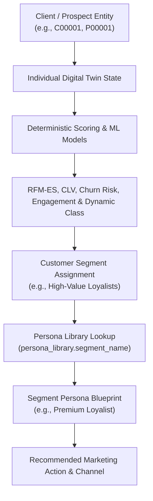

# OSMOS — Digital Twin vs. Persona Modeling Layer

## 1. Conceptual Distinction Overview

A fundamental design principle of OSMOS is the strict separation between individual customer representations (**Digital Twin**) and group-level behavioral abstractions (**Persona**).

> [!IMPORTANT]
> **Digital Twin $\neq$ Persona**
> - **Digital Twin**: Belongs strictly to an **individual customer or prospect entity**. It represents real-time state, exact numerical features, transaction history, and calculated score vectors.
> - **Persona**: Belongs strictly to a **segment cohort**. It represents an operational marketing blueprint, communication tone, and strategy guideline applicable to all entities matching that segment.

---

## 2. Component Specifications

### A. The Individual Digital Twin
The Digital Twin is a dynamic computational mirror of a single entity (`entity_id` e.g., `C00001` for Client, `P00001` for Prospect, or `P01501` for Converted Prospect).

It encapsulates:
1. **Core Identity**: Entity ID, Entity Type (Client vs. Prospect), Creation Date, Conversion Timestamp.
2. **Behavioral State Vector**: Recency (days), 30-day Visits, 30-day Product Views, 30-day Cart Additions, 90-day Purchases, 90-day Total Spend (MAD), Average Order Value (MAD), Email Open/Click Rates, Complaint Counts, Review Scores, Social Sentiment.
3. **Predictive & Value Score Vector**: RFM-ES Score, Predicted CLV Amount (MAD), Predicted CLV Segment, Churn Risk Class, Behavioral Engagement Score, Decision Priority Score.
4. **Historical Track Record**: Sequence of event simulations, historical CLV evolution, RFM score progression, classification history, and segment transitions over time.

### B. Segment
A **Segment** is an analytical cohort that clusters entities exhibiting similar behavioral characteristics, value ranges, or risk profiles (e.g., `High-Value Loyalists`, `At-Risk Big Spenders`, `Prospect`).

### C. Persona
A **Persona** is a humanized marketing blueprint mapped directly to a segment. It translates technical score vectors into operational strategy guidelines (e.g., `Premium Loyalist`, `Churn Risk VIP`, `New Explorer`).

---

## 3. The Resolution Chain Flow

To prevent arbitrary persona assignment, OSMOS enforces a strict, single-direction scientific resolution chain:

---

## 4. Resolution Chain Execution Summary

| Entity ID | Entity Type | Resolved Segment | Persona Blueprint | Primary Marketing Channel | Priority |
| :--- | :--- | :--- | :--- | :--- | :--- |
| `C00001` | Client | High-Value Loyalists | Premium Loyalist | Direct Phone / Email VIP | High |
| `P00001` | Prospect | Prospect | New Explorer | Email / Web Popup | Medium |
| `P01501` | Client (Converted Prospect) | High-Value Loyalists | Premium Loyalist | Direct Phone / Email VIP | High |

---

## 5. Summary Rules
1. Every entity has exactly **one active Digital Twin**.
2. Every Digital Twin maps to exactly **one active Segment** based on deterministic feature thresholds.
3. Every Segment maps to exactly **one active Persona Blueprint** defined in the system's `persona_library`.
