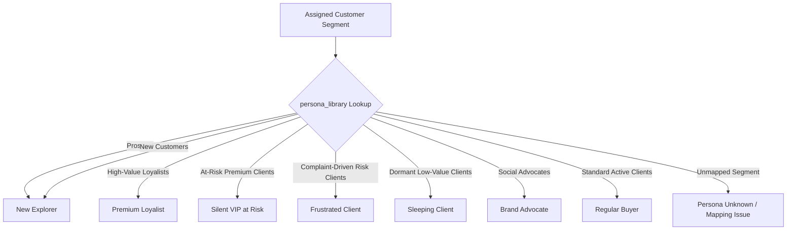

# OSMOS Digital Twin & Persona Modeling Specification

This document specifies the data structure, behavioral parameterization, and persona resolution methodology governing the **Digital Twin Profile** and **Persona Library** in **OSMOS**.

---

## 1. Digital Twin Profile Architecture

The **Digital Twin Profile** (`digital_twin/`) represents a dynamic virtual copy of a customer entity.

### Profile Core Attributes:
- **Core Identity**: Entity ID, Entity Type (`Prospect` / `Client`), registration timestamp, geographic location.
- **Behavioral Telemetry**: Recency (days since last activity), Frequency (total transaction count), Monetary spend (MAD), review scores ($1.0 - 5.0$), complaint count, channel preferences.
- **Predictive Metrics**: RFM-ES score ($0.0 - 1.0$), Churn Risk score ($0.0 - 1.0$), Predicted CLV Amount (MAD), Predicted CLV score ($0.0 - 1.0$).
- **Lifecycle Cohort**: Dynamic lifecycle classification (`Cold Prospect`, `Warm Prospect`, `Active Client`, `VIP Client`, `Churn Risk Client`).
- **Segment & Persona**: Quantitative customer segment assignment and resolved stable persona.

---

## 2. Stable Business Personas vs Dynamic Analytical Clusters

OSMOS maintains a clear distinction between **Stable Business Personas** and **Dynamic Analytical Clusters**:

| Dimension | Stable Business Persona | Dynamic Analytical Cluster |
| :--- | :--- | :--- |
| **Definition** | Official, standardized business profile catalog defined in `persona_library`. | Exploratory data science cluster generated dynamically via unsupervised K-Means. |
| **Governance** | Governed by deterministic segment-first business rules. | Updated dynamically upon model retrain. |
| **Use Case** | Executive decision-making, supervision agent audits, marketing campaign dispatches. | Exploratory audience discovery, feature drift analysis. |

---

## 3. Official Segment-to-Persona Mapping Rules

To enforce business alignment, personas are resolved using segment-first mapping from `persona_library`:

### Mapping Matrix:

| Quantitative Customer Segment | Official Stable Persona | Strategic Persona Focus |
| :--- | :--- | :--- |
| **Prospect** | `New Explorer` | Brand orientation & onboarding |
| **New Customers** | `New Explorer` | First-purchase conversion & activation |
| **High-Value Loyalists** | `Premium Loyalist` | Exclusive VIP perks & retention |
| **At-Risk Premium Clients** | `Silent VIP at Risk` | Executive concierge outreach & service recovery |
| **Complaint-Driven Risk Clients** | `Frustrated Client` | Urgent service recovery & issue resolution |
| **Dormant Low-Value Clients** | `Sleeping Client` | Low-cost re-engagement nurturing |
| **Social Advocates** | `Brand Advocate` | Referral incentives & social amplifications |
| **Standard Active Clients** | `Regular Buyer` | Routine cross-sell & loyalty rewards |

### Persona Mapping Issue Detection:
If a customer entity is assigned a valid segment but `customer_persona` returns `None` or `Unknown`, the `PersonaAgent` flags a **Persona Mapping Issue** (`CONF_PERS_MAP_001`). Administrators can resolve this issue by executing `seed_default_personas()` or updating `persona_library`.
