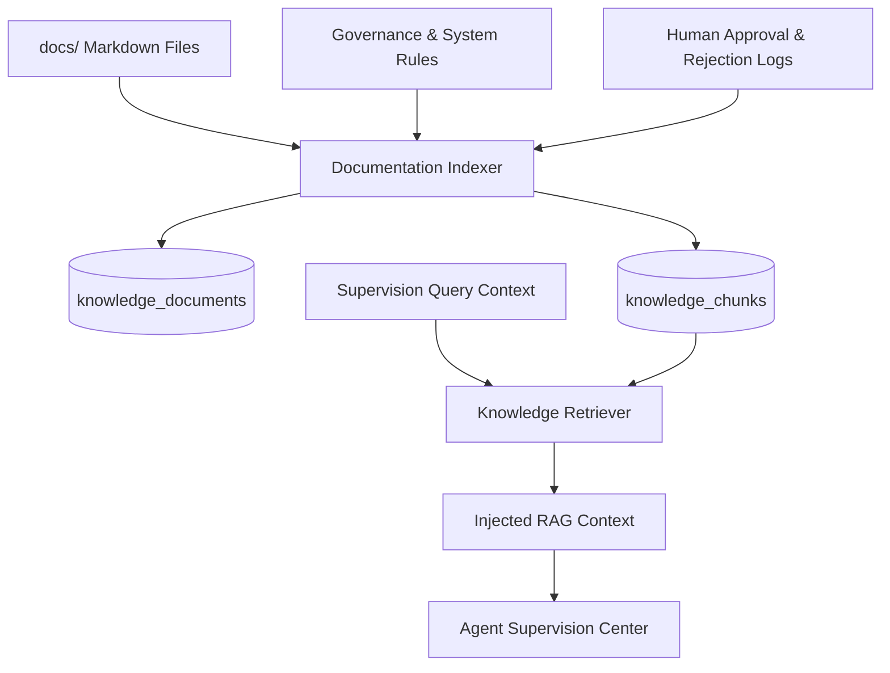
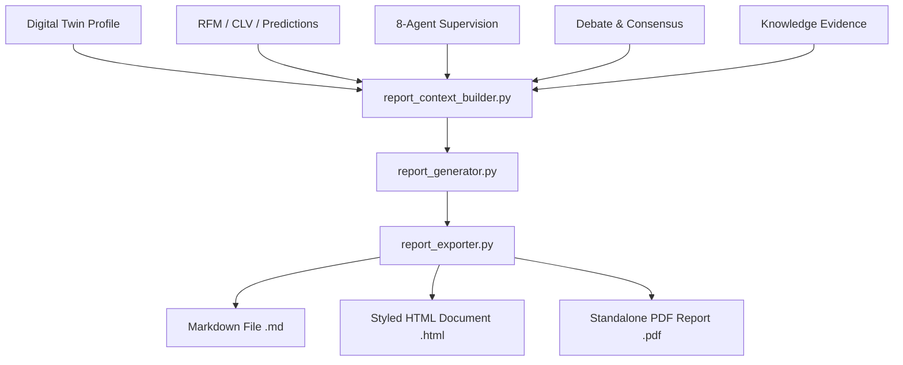

# OSMOS Executive Reports & RAG Knowledge Base Guide

This document specifies the architecture, indexing pipeline, and generation workflows for **RAG Knowledge Base Memory** and **Executive Reports** in **OSMOS**.

---

## 1. RAG Knowledge Base Architecture

The **Knowledge Base** (`knowledge/`) equips OSMOS with internal documentation memory and historical decision traceability.

### Table Definitions:
- **`knowledge_documents`**: Master header table storing title, document source type (`documentation`, `system_rule`, `decision`), file path, and index date.
- **`knowledge_chunks`**: Chunked text passages (with 500-character windows and 50-character overlaps) tagged with metadata keywords for search retrieval.

### Governance Principle:
> RAG Knowledge Memory does **not** replace analytical agents. It provides historical decision traceability and governance context to support agent consensus.

---

## 2. Executive Report Generator

The **Executive Report Generator** (`reports/`) compiles Digital Twin states, model metrics, agent supervision findings, debate consensus, and RAG knowledge evidence into multi-format executive reports.

### Supported Report Types:
1. **Entity Executive Report**: Deep-dive profile report for an individual client or prospect (`P_DEMO_001`, etc.).
2. **Agent Run Report**: Audit document capturing the execution output of the 8 supervision agents.
3. **Journey Report**: Lifecycle scenario progression summary detailing step-by-step stage transitions.
4. **System Overview Report**: High-level cluster health, database metrics, and aggregate portfolio statistics.

---

## 3. Export Formats & Safety Controls

- **Supported Export Formats**: Markdown (`.md`), HTML with embedded CSS styling (`.html`), and standalone PDF (`.pdf`).
- **Read-Only Guarantee**: Report compilation is 100% read-only with zero database mutations.
- **Button-Triggered LLM Summaries**: Executive summaries generated via local LLMs are strictly button-triggered ("LLM Executive Polish"). Zero background calls occur during report generation.
