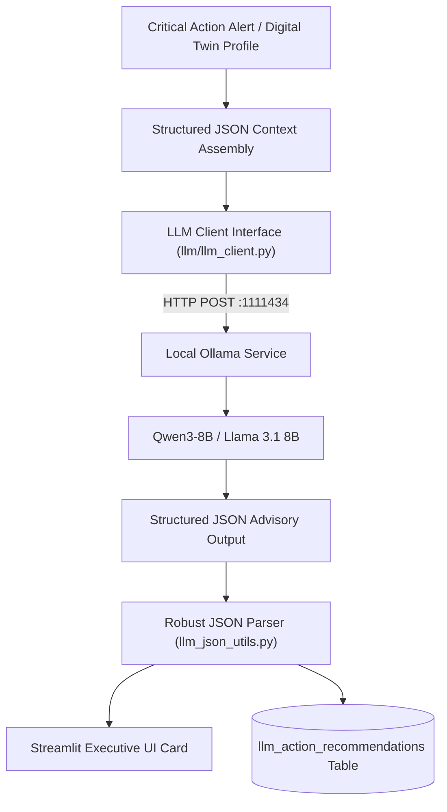

# OSMOS — Local LLM-Assisted Action Intelligence Layer

## 1. Local LLM Architecture & Rationale

OSMOS integrates an on-demand, local Large Language Model (LLM) advisory layer powered by **Ollama**.

### Supported Models:
1. **Primary Model**: `qwen3:8b` (Optimal balance of structured JSON generation, multi-lingual FR/EN fidelity, and fast inference).
2. **Fallback Model**: `llama3.1:8b`
3. **Lightweight Model**: `phi4-mini`

### Strategic Rationale for Local LLM:
- **Privacy & Compliance**: Zero customer data or behavioral features leave the local infrastructure.
- **Cost Elimination**: No per-token API charges or external cloud dependencies.
- **System Independence**: Operates seamlessly in isolated, air-gapped enterprise environments.

---

## 2. Guardrails & Execution Rules

To ensure operational reliability and performance stability, OSMOS enforces strict LLM guardrails:

1. **Button-Triggered Only**: LLM generation is NEVER auto-triggered on page load or background startup. It executes solely when the admin clicks `🤖 Generate Recommendation` or `🤖 Generate Digital Twin Summary`.
2. **Deterministic Primacy**: System decisions, CLV predictions, RFM scores, and alert flags are 100% computed by python ML modules prior to invoking the LLM.
3. **Structured JSON Enforcement**: LLM prompts require valid JSON outputs containing executive summaries, action steps, channel suggestions, and message drafts in both French (FR) and English (EN).
4. **Graceful Fallbacks**: If Ollama is offline or times out (30s limit), the system renders structured deterministic recommendations without crashing the app.
