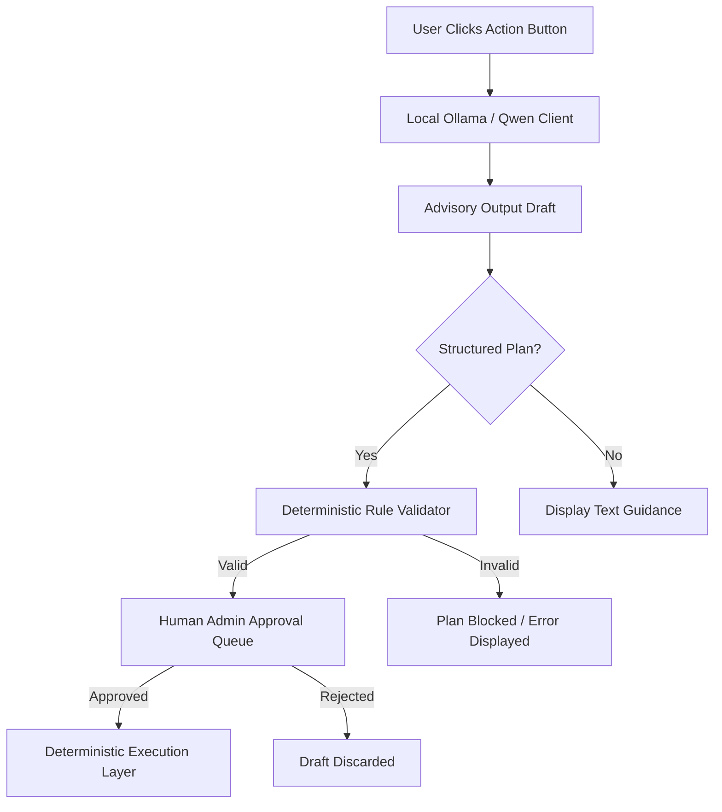

# OSMOS LLM-Assisted Action Intelligence Specification

This document specifies the integration, safety rules, validation workflow, and governance principles for **LLM-Assisted Action Intelligence** in **OSMOS**.

---

## 1. Governance & Safety Rules

OSMOS enforces strict safety rules governing all Large Language Model (LLM) operations:

### Mandatory Governance Rules:
1. **Advisory Role Only**: The LLM operates purely in an advisory capacity. It cannot modify customer records, update database rows, or dispatch real marketing campaigns autonomously.
2. **Button-Triggered Execution**: LLM invocations occur **only** when an administrator explicitly clicks an action button (e.g. "Generate LLM Recommendation", "Generate LLM Scenario Plan"). Zero automatic LLM calls occur on page load, background timers, or inside data fetch routines (`get_data()`).
3. **No Direct Database Writes**: The LLM client never issues `INSERT`, `UPDATE`, or `DELETE` SQL queries directly against database tables.
4. **Deterministic Validation Required**: Any structured payload proposed by an LLM (such as a multi-stage journey scenario plan) must be parsed, normalized, and validated by deterministic business rules before presentation to an administrator.
5. **Human Approval Mandate**: Admin review and explicit approval are required before any generated action plan can be applied to customer records.
6. **Local Deployment Privacy**: The LLM runs via a local **Ollama** instance (`qwen2.5` / `llama3`). Zero customer data or telemetry is transmitted to external cloud APIs.
7. **Deterministic Fallback**: If the local LLM service is offline or unconfigured, system modules fall back gracefully to rule-based template logic without crashing the application.

---

## 2. LLM-Assisted Journey Scenario Planner

The **LLM Journey Planner** (`journey/llm_journey_planner.py`) enables administrators to propose candidate lifecycle scenarios for demo entity `P_DEMO_001`.

### Verification Sequence:
1. **Proposal Generation**: LLM returns a structured candidate JSON proposal containing scenario metadata, target stages, behavioral events, and expected state changes.
2. **JSON Repair & Normalization**: Utility functions (`journey/llm_json_utils.py`) clean trailing commas, repair missing brackets, and extract valid JSON payloads.
3. **Deterministic Validation**: `validate_llm_journey_plan()` evaluates candidate plans against 10 strict business rules:
   - Target entity must equal `P_DEMO_001`.
   - Event types must belong to the allowed telemetry catalog.
   - Event offset days must be chronologically non-decreasing.
   - `purchase` events must occur only after conversion to `Client`.
   - VIP stages must contain high-value purchase telemetry ($>1,000$ MAD).
   - Churn stages must contain negative friction signals (`complaint`, `inactivity_period`).
   - Expected segments must map to valid personas in `persona_library`.
   - Payload must contain zero PII or unknown event fields.
4. **Quality Scoring**: Evaluated plans receive a quality score ($0 - 100$) and quality label (`Excellent`, `Acceptable`, `Weak`, `Invalid`).
5. **Admin Approval & Execution**: Valid plans are rendered as visual cards for administrator review. Upon approval, the deterministic `JourneyRunner` applies events and writes `event_history` records to PostgreSQL.
