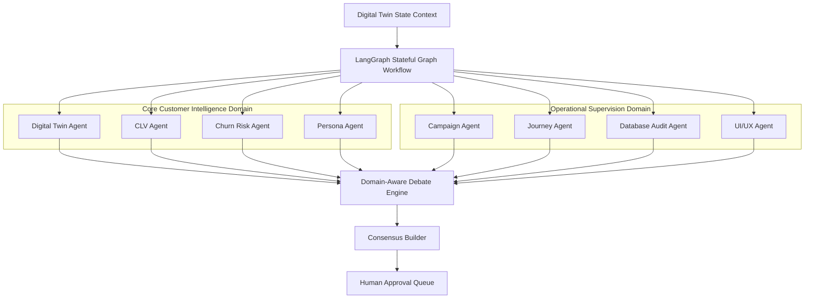
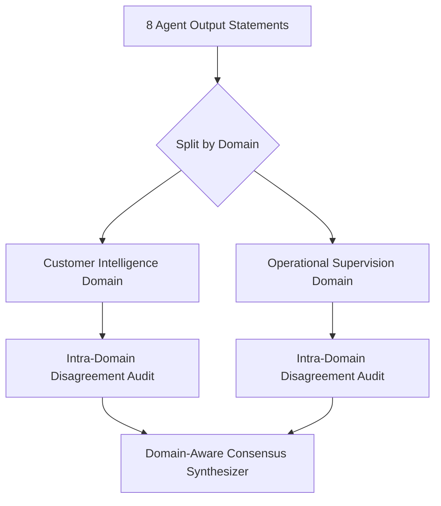

# OSMOS Multi-Agent Supervision & Domain-Aware Debate Guide

This document provides a comprehensive technical guide to the **Multi-Agent Supervision Layer** and **Domain-Aware Debate Mode** in **OSMOS**.

---

## 1. Multi-Agent Supervision Framework Overview

OSMOS implements a multi-agent supervision framework designed to audit customer states, identify risk factors, verify business persona consistency, and propose human-in-the-loop operational actions.

---

## 2. Agent Roster & Analytical Focus

### Customer Intelligence Domain
- **Digital Twin Agent (`agents/digital_twin_agent.py`)**: Audits identity completeness, registration timestamps, and behavioral state telemetry consistency.
- **CLV Agent (`agents/clv_agent.py`)**: Monitors monetary spend velocity, lifetime value scores, and VIP customer value collapse.
- **Churn Risk Agent (`agents/churn_risk_agent.py`)**: Computes churn probabilities based on inactivity days, review scores, and complaint counts.
- **Persona Agent (`agents/persona_agent.py`)**: Verifies segment-first stable persona assignments and identifies unmapped customer segments.

### Operational Supervision Domain
- **Campaign Agent (`agents/campaign_agent.py`)**: Audits campaign dispatches, marketing gaps, and response alignments.
- **Journey Agent (`agents/journey_agent.py`)**: Tracks lifecycle scenario stage transitions and trigger event references.
- **Database Audit Agent (`agents/database_audit_agent.py`)**: Monitors PostgreSQL table row counts, orphaned foreign key references, and schema integrity.
- **UI/UX Agent (`agents/ui_ux_agent.py`)**: Assesses demonstration readiness, PII safety, and executive presentation suitability.

---

## 3. LangGraph Workflow Graph Topology

Multi-agent supervision is orchestrated using **LangGraph** (`agents/langgraph_supervision/`), which executes nodes sequentially while maintaining state in `SupervisionState`:

1. `build_context_node`: Assembles Digital Twin state and queries Knowledge Base memory.
2. `run_core_agents_node`: Executes Core Customer Intelligence Agents.
3. `run_operational_agents_node`: Executes Operational Supervision Agents.
4. `aggregate_results_node`: Aggregates findings and assigns global status.
5. `debate_node` (Conditional): Runs domain-aware conflict detection and consensus synthesis.
6. `finalize_node`: Finalizes supervision outputs.
7. `prepare_approval_actions_node`: Populates items for `agent_approval_queue`.

---

## 4. Domain-Aware Conflict Detection Rules

The conflict detector evaluates agent positions strictly within domain groupings to eliminate false contradictions:

### Key Domain Principles:
1. **CLV Validity vs Churn Risk**: A `CLV Agent OK` status indicates model computation validity, not customer health. `CLV OK` vs `Churn Critical` is not a contradiction. Low CLV + High Churn resolves as:
   > *"Retention action should be cost-efficient because churn risk is high but CLV is low."*
2. **Journey Status vs Churn Risk**: `Journey Agent OK` verifies scenario structure integrity, not customer health.
3. **Database Audit Classification**: A Database Audit warning with 0 orphaned references is classified as a *"demo readiness / initialization warning"*, not a data integrity issue.

---

## 5. Human Approval Queue & Governance

All agent recommendations undergo human-in-the-loop review via `agent_approval_queue`:
- Status transitions: `Pending` $\rightarrow$ `Approved` / `Rejected` $\rightarrow$ `Converted to Campaign Draft`.
- Zero automated database mutations or campaign dispatches occur without explicit administrator approval.
