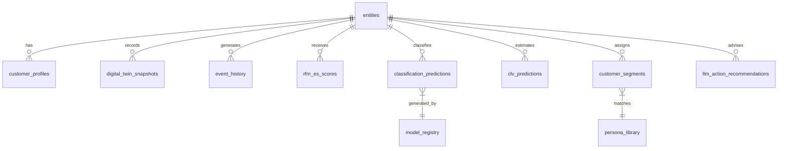

# OSMOS — PostgreSQL Persistence & Historical Intelligence Layer

## 1. Why PostgreSQL Was Integrated

Initial prototypes relied exclusively on flat Excel spreadsheets (`osmos_crm_dataset.xlsx`). While simple, flat files present critical limitations for enterprise CRM operations:
- **No Historical Versioning**: Overwriting rows destroys historical track records of predictions and score changes.
- **Race Conditions**: Concurrent simulation updates cause file lock failures and data corruption.
- **Query Performance**: In-memory full dataframe recalculations scale poorly beyond thousands of rows.

**PostgreSQL Foundation Benefits**:
1. **Full Historical Versioning**: Every prediction, segment assignment, and event is timestamped and stored immutably.
2. **Audit Traceability**: Complete audit log of admin actions, simulations, and LLM advice generations.
3. **Optimized Query Performance**: Indexed time-series queries for transition matrices and drift detection.
4. **Single-Entity Snapshot Updates**: Fast single-row transactions ($< 10\text{ ms}$) replacing full-file writes.

---

## 2. PostgreSQL Schema Specification

The `osmos_db` database consists of 12 core tables:

### Table Dictionary Summary:
- `entities`: Primary registry of customers (`Client`) and prospects (`Prospect`).
- `customer_profiles`: Extended demographic and contact attributes.
- `digital_twin_snapshots`: Time-series store of raw behavioral feature vectors.
- `event_history`: Immutable log of simulated and real-world interactions (Purchases, Complaints, Visits).
- `rfm_es_scores`: Historical record of computed RFM-ES score vectors.
- `classification_predictions`: Time-series store of model dynamic class predictions.
- `clv_predictions`: Time-series store of predicted CLV MAD amounts and scores.
- `customer_segments`: History of segment assignments per entity.
- `persona_library`: Catalog of 10 predefined segment-to-persona marketing blueprints.
- `llm_action_recommendations`: Log of LLM generated cognitive summaries, recommendations, and feedback ratings.
- `model_registry`: Version registry of trained machine learning model artifacts.
- `audit_logs`: Operations log tracking system events, batch runs, and errors.
