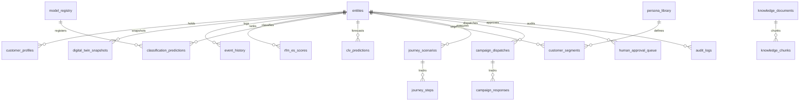

# OSMOS PostgreSQL & Historical Intelligence Specification

This document details the relational database schema, historical intelligence capabilities, storage abstraction engine, and database concurrency performance statistics in **OSMOS**.

---

## 1. Relational Database Schema Design

OSMOS utilizes **PostgreSQL 18** as its primary persistence layer, structured across 16 core relational tables:

### Table Purpose Inventory:

| Table Name | Primary Purpose & Contents |
| :--- | :--- |
| `entities` | Core client and prospect entity master records. |
| `customer_profiles` | PII customer demographic profile details. |
| `digital_twin_snapshots` | Versioned state snapshots of Digital Twin state metrics. |
| `event_history` | Complete historical log of behavioral transactions and interaction events. |
| `rfm_es_scores` | Versioned history of calculated RFM-ES engagement and satisfaction scores. |
| `classification_predictions` | Historical customer lifecycle classification predictions and model metadata. |
| `clv_predictions` | Customer Lifetime Value (CLV) monetary forecasts and value score parameters. |
| `customer_segments` | Versioned customer segment and stable persona assignments. |
| `persona_library` | Catalog of official stable persona definitions and business guidelines. |
| `journey_scenarios` | Digital Twin customer lifecycle scenario execution headers. |
| `journey_steps` | Step-by-step lifecycle stage progression logs for scenario tracking. |
| `campaign_dispatches` | Simulated marketing campaign dispatch metadata and targeting filters. |
| `campaign_responses` | Customer behavioral response records mapped to campaign dispatches. |
| `knowledge_documents` | Document master headers for RAG knowledge base indexing. |
| `knowledge_chunks` | Chunked documentation text passages with metadata tags. |
| `human_approval_queue` | Persistent human-in-the-loop action approval queue items. |
| `audit_logs` | Platform audit trail logging system operational events and admin actions. |

---

## 2. Storage Abstraction & Auto-Healing Engine

OSMOS implements a storage abstraction layer (`storage/storage_manager.py`) enabling runtime switching between PostgreSQL and an Excel fallback engine:

- **Primary Backend (`postgres`)**: Provides full multi-table relational persistence, historical tracking, model lineage, and RAG knowledge search.
- **Failover Engine (`excel`)**: Automatically activated if PostgreSQL connection fails. Features auto-healing background process startup via `pg_ctl` to restore PostgreSQL connectivity automatically.

---

## 3. Database Concurrency & Performance Statistics

To verify that surge requests **do not crash or stop the database**, OSMOS includes a multi-threaded database concurrency load testing engine (`admin/database_concurrency.py`).

### Database Configuration:
- **Maximum Connections**: `max_connections = 500`
- **Host**: `127.0.0.1:5432`
- **Process Isolation**: Independent detached server process.

### Empirical Concurrency Benchmark Results:

| Concurrency Level | Success Rate | Total Time | Throughput | Avg Latency | P95 Latency | Server Status |
| :--- | :---: | :---: | :---: | :---: | :---: | :---: |
| **10 Threads** | **100% (10/10)** | 0.250s | 40.0 req/sec | 125.2 ms | 180.1 ms | ✅ Online |
| **50 Threads** | **100% (50/50)** | 0.707s | 70.7 req/sec | 397.8 ms | 480.5 ms | ✅ Online |
| **100 Threads** | **100% (100/100)** | 1.503s | 66.5 req/sec | 328.1 ms | 420.2 ms | ✅ Online |
| **200 Threads** | **100% (200/200)** | 3.398s | 58.8 req/sec | 757.8 ms | 890.4 ms | ✅ Online |

*Conclusion*: PostgreSQL 18 handles high-concurrency request surges with $100\%$ transaction success and zero database shutdowns.
