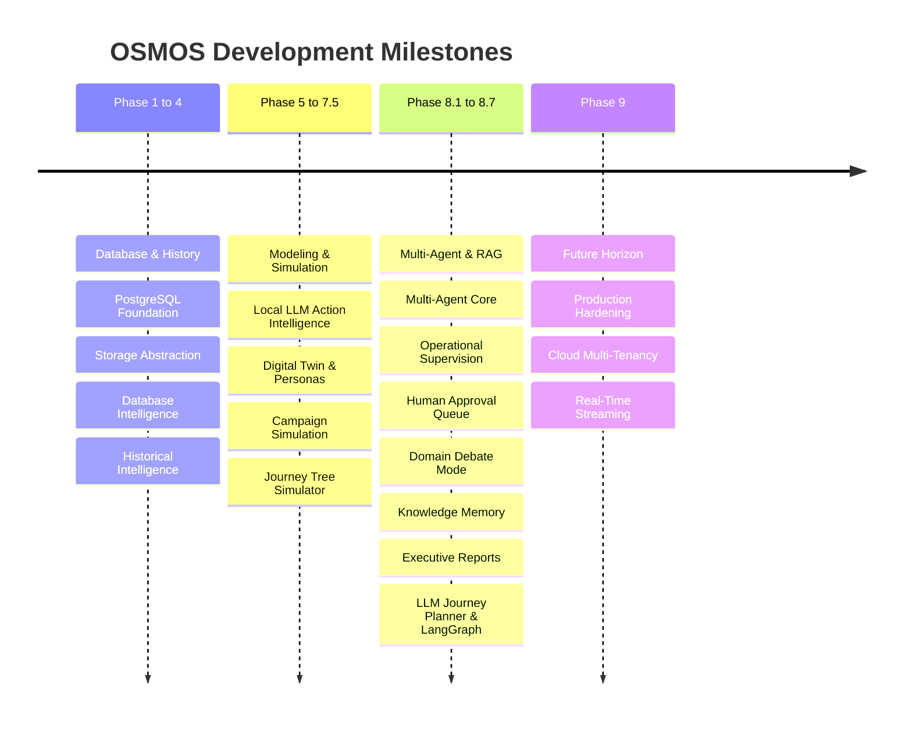

# OSMOS System Development Roadmap

This document outlines the evolutionary phases of the **OSMOS** (Omnichannel Supervised Marketing Optimization System) platform, detailing completed architectural milestones and future production deployment goals.

---

## Roadmap Overview

---

## Completed Development Phases

### Phase 1 — PostgreSQL Foundation
- Implemented PostgreSQL schema (`entities`, `customer_profiles`, `event_history`, `rfm_es_scores`, `classification_predictions`, `clv_predictions`, `customer_segments`, `persona_library`, `audit_logs`).
- Automated DDL schema creation and index optimization.

### Phase 2 — Storage Abstraction & Failover Engine
- Created unified `StorageManager` supporting seamless runtime switching between `postgres` and `excel` engines.
- Implemented auto-healing server detection for PostgreSQL 18 with detached background process startup.

### Phase 3 — Database Intelligence
- Developed the Database Intelligence Dashboard to monitor cluster health, table row counts, and database storage sizes.
- Implemented audit logging for operational actions.

### Phase 4 — Historical Intelligence
- Built time-series tracking for RFM-ES score evolution, CLV trend alerts, dynamic classification drift, and segment transitions.
- Added table-level historical intelligence inspection.

### Phase 5 — Local LLM-Assisted Action Intelligence
- Integrated local Ollama (Qwen) LLM client for button-triggered marketing action generation.
- Implemented `ActionRecommendationsRepository` and bilingual output formatting (English / French).

### Phase 6 — Digital Twin & Persona Modeling
- Formulated the Digital Twin core profile structure, unifying core identity, behavioral state, predictive parameters, and segment assignments.
- Standardized stable business personas mapped deterministically from customer segments.

### Phase 6.5 — Documentation & Scientific Explanation
- Authored theoretical documentation, mathematical formulations for RFM-ES, CLV, Churn, and architectural specifications.

### Phase 7 — Closed-Loop Campaign Simulation
- Developed closed-loop marketing campaign simulator (`campaign_dispatches`, `campaign_responses`).
- Integrated automated customer behavioral response generator (conversion, complaint, opt-out).

### Phase 7.5 — Journey Tree Simulator
- Created the controlled lifecycle scenario generator for demo entity `P_DEMO_001`.
- Built 6-stage lifecycle progression executing real PostgreSQL history inserts.

### Phase 8.1 — Multi-Agent Foundation
- Developed core customer intelligence agents: `DigitalTwinAgent`, `CLVAgent`, `ChurnRiskAgent`, and `PersonaAgent`.

### Phase 8.2 — Operational Supervision Agents
- Developed operational supervision agents: `CampaignAgent`, `JourneyAgent`, `DatabaseAuditAgent`, and `UIUXAgent`.
- Implemented global status aggregation and Next Best Action (NBA) selection rules.

### Phase 8.3 — Agent Memory & Human Approval Workflow
- Created persistent `human_approval_queue` repository for agent-generated operational recommendations.
- Implemented approval workflow (Pending, Approved, Rejected, Executed).

### Phase 8.4 — Agent Collaboration & Domain-Aware Debate Mode
- Built deterministic cross-agent debate engine (`DebateEngine`, `ConflictDetector`, `ConsensusBuilder`).
- Established domain-aware conflict detection (Customer Intelligence Domain vs Operational Supervision Domain) to resolve status differences logically.

### Phase 8.5 — Agent Knowledge Base & Decision Memory
- Implemented document indexing pipeline (`knowledge_documents`, `knowledge_chunks`) for internal documentation and approval history.
- Integrated RAG-driven context memory into the Agent Supervision Center.

### Phase 8.6 — Executive Report Generator
- Built multi-format report generator supporting Entity Executive Reports, Agent Run Reports, Journey Reports, and System Overview Reports.
- Added export capabilities for Markdown, HTML, and standalone PDF files.

### Phase 8.7 — LLM-Assisted Journey Scenario Planner & LangGraph Orchestration
- Integrated LangGraph as the primary stateful workflow engine for multi-agent supervision.
- Developed LLM-assisted Journey Planner proposing candidate scenarios validated deterministically before execution.
- Added real-time database concurrency stress testing and connection pool monitoring.

### Phase 8.8 — A/B Test & Digital Twin Response Simulator
- Developed the `ab_testing/` module allowing administrators to formulate A/B testing questions and generate campaign variants manually or via button-triggered local LLMs.
- Implemented deterministic 14-rule variant validator, Digital Twin behavioral response simulator, multi-variant score ranking ($0-100$), and academic decision recommendation synthesis.
- Added human governance controls: saving experiment records in PostgreSQL (`ab_test_experiments`, `ab_test_variants`, `ab_test_simulated_responses`, `ab_test_recommendations`), converting winning variants to simulated campaign drafts, and applying simulated response events.

---

## Future Horizon

### Phase 9 — Production Hardening & Deployment Readiness
- **Production Containerization**: Multi-stage Docker packaging for Streamlit frontend, LangGraph supervisor, and PostgreSQL 18 cluster.
- **Role-Based Access Control (RBAC)**: Fine-grained permissions for marketing managers, data scientists, and system administrators.
- **Kafka / Event Streaming Integration**: Real-time event ingestion pipeline replacing batch polling.
- **Automated CI/CD**: End-to-end integration testing and database migration verification pipeline.
