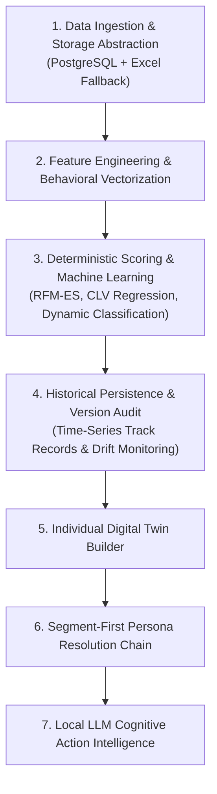

# OSMOS — Scientific Explanation & Conceptual Framework

## 1. Executive Summary & Project Identification

* **Project Name**: OSMOS — Optimal Smart Marketing Operation System
* **Domain**: Artificial Intelligence in Customer Relationship Management (CRM) & Marketing Operations
* **System Type**: AI-Powered Digital Twin & Multi-Layered Action Intelligence Platform

### Definition
**OSMOS (Optimal Smart Marketing Operation System)** is an enterprise AI-powered Digital Twin CRM and marketing intelligence platform. It dynamically models individual customers and prospects through continuously evolving digital representations, multi-dimensional predictive score vectors (RFM-ES, CLV, Churn Risk), segment-level persona blueprints, advanced historical audit tracking, and button-triggered local LLM action recommendations.

---

## 2. Core Objectives

The primary scientific and operational objectives of OSMOS are:

1. **Individual-Level Dynamic Representation**: Transform static CRM database records into living, event-driven Digital Twins that evolve in real time with each customer interaction or simulation.
2. **Predictive Value & Risk Estimation**: Provide multi-variate continuous scoring including Recency-Frequency-Monetary-Engagement-Sentiment (RFM-ES) vectors, Customer Lifetime Value (CLV in MAD), and Churn Risk probabilities.
3. **Decoupled Cohort Segmentation & Persona Modeling**: Separate individual entity behavior from group-level persona archetypes to eliminate arbitrary persona tagging and enforce scientific segment resolution (`entity_id` ➔ `customer_segment` ➔ `persona_library` ➔ `persona`).
4. **Historical Intelligence & Drift Auditing**: Track long-term CLV evolution, segment transition matrices, and prediction distribution drift over historical timeframes using PostgreSQL versioning.
5. **Cognitive Action Support**: Integrate local LLMs (Ollama Qwen3-8B / Llama 3.1 8B) as an advisory layer to explain deterministic alerts and suggest high-converting, personalized marketing actions without substituting deterministic core analytics.

---

## 3. Scientific Contribution & Innovation Framework

OSMOS bridges the gap between raw machine learning analytics and actionable marketing operations through a unified 7-layer architecture:

### Key Innovations:
- **Hybrid Storage Abstraction**: High-performance PostgreSQL persistence combined with zero-friction Excel fallback for lightweight environments.
- **Single-Entity Snapshot Delta Saves**: Low latency event simulations (< 1s execution) achieved by updating only affected entity rows instead of re-processing full dataset frames.
- **AHP-Weighted Multi-Criteria Scoring**: Analytical Hierarchy Process (AHP) weighting for custom, scientifically sound RFM-ES score synthesis.
- **Deterministic-first AI Architecture**: Machine learning models and mathematical formulas handle 100% of calculations; LLM models are restricted to qualitative explanation and advice generation.
- **Multi-Agent Supervision Layer (Phase 8)**: Coordinates specialized analytical agents (Digital Twin, CLV, Churn Risk, Persona) under a deterministic Orchestrator to synthesize entity-level risks, opportunities, evidence traceability, and Next Best Actions in read-only mode.

---

## 4. Multi-Agent Supervision, Debate, Knowledge & LangGraph Orchestration (Phase 8.1 - 8.7)

The **Multi-Agent Supervision Layer** extends OSMOS into a coordinated intelligent supervision system. An **Orchestrator Agent** constructs the customer context and delegates analysis to 8 specialized agents responsible for Digital Twin consistency, CLV value evolution, churn risk detection, persona consistency, campaign outcomes, journey step integrity, database auditability, and UI/demo readiness.

Phase 8.4 introduced **Agent Collaboration & Debate Mode**, where agents compare findings, detect risk vs. opportunity conflicts, and synthesize consensus decisions.

Phase 8.5 introduced **Agent Knowledge Base & Documentation Memory**, allowing agents to retrieve internal documentation, governance rules, and decision history (`agent_runs`, `agent_outputs`, `agent_approval_queue`).

Phase 8.6 implemented the **Executive Report Generator** (`reports/` package).

Phase 8.7 introduces **LangGraph Supervision Workflow Orchestration** (`agents/langgraph_supervision/` package). OSMOS uses LangGraph as an explicit stateful workflow orchestration layer. Existing deterministic agents are wrapped as graph nodes (`build_context_node`, `run_core_agents_node`, `run_operational_agents_node`, `aggregate_results_node`, `debate_node`, `finalize_orchestration_node`, `prepare_approval_actions_node`), while conditional edges route graph state based on error states and debate flags. This makes multi-agent supervision stateful, inspectable, modular, and easier to extend while preserving read-only governance, deterministic execution, and human approval.

