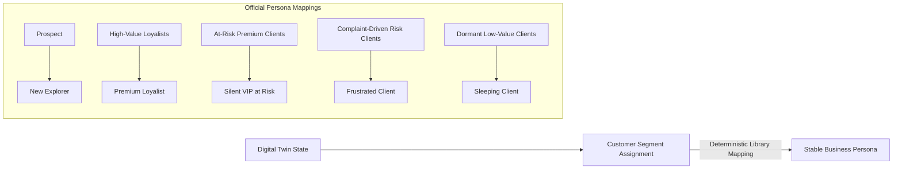
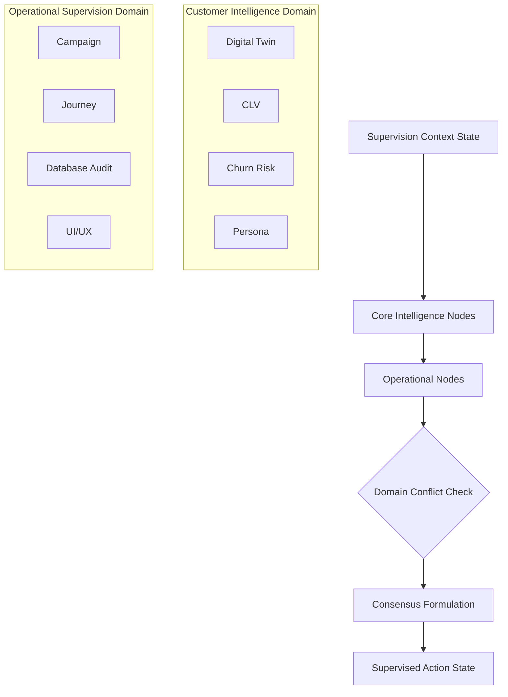

# OSMOS Scientific & Mathematical Foundations

This document provides the theoretical foundations, mathematical formulations, and algorithmic specifications governing the **OSMOS** platform.

---

## 1. Digital Twin CRM State Space Formulation

OSMOS models each customer as a discrete-time **Digital Twin State System**. Let $\mathcal{E}_i$ represent customer entity $i$ at discrete time $t_k$. The state vector $S_i(t_k)$ is defined as:

$$S_i(t_k) = \left\langle I_i, B_i(t_k), P_i(t_k), \mathcal{C}_i(t_k), \mathcal{P}_i(t_k) \right\rangle$$

Where:
- $I_i$: Immutable core identity attributes (Entity ID, registration date, geographic region).
- $B_i(t_k)$: Behavioral telemetry state (recency $R_i$, frequency $F_i$, total monetary spend $M_i$, review score $V_i$, complaint count $K_i$).
- $P_i(t_k)$: Predictive state vector (RFM-ES score, churn probability $P(\text{Churn}_i)$, predicted CLV amount $\widehat{\text{CLV}}_i$).
- $\mathcal{C}_i(t_k)$: Dynamic lifecycle class (Cold Prospect, Warm Prospect, Active Client, VIP Client, Churn Risk Client).
- $\mathcal{P}_i(t_k)$: Resolved stable persona mapping.

State transitions occur upon receipt of discrete behavioral telemetry events $e \in \mathcal{E}_{\text{events}}$:

$$S_i(t_{k+1}) = f_{\text{transition}}\left(S_i(t_k), e(t_{k+1})\right)$$

---

## 2. Mathematical Formulations

### A. RFM-ES (Engagement & Satisfaction) Scoring
Standard RFM models evaluate only Recency, Frequency, and Monetary spend. OSMOS extends this formulation into **RFM-ES** by incorporating Engagement ($E_i$) and Satisfaction ($S_i$):

$$\text{RFM-ES}_i = w_R \cdot \Phi(R_i) + w_F \cdot \Phi(F_i) + w_M \cdot \Phi(M_i) + w_E \cdot \Phi(E_i) + w_S \cdot \Phi(S_i)$$

Where $\Phi(\cdot)$ represents min-max percentile normalization onto $[0, 1]$, and weights satisfy $\sum w = 1.0$ (Default weights: $w_R=0.25, w_F=0.25, w_M=0.25, w_E=0.15, w_S=0.10$).

### B. Customer Lifetime Value (CLV) Forecasting
CLV is projected over horizon $T$ using a modified Pareto/NBD-Gamma framework combined with deterministic monetary spend scaling:

$$\widehat{\text{CLV}}_i = M_{\text{avg}, i} \cdot \left( \frac{\lambda_i}{\mu_i + \gamma} \right) \cdot \left( 1 - e^{-(\mu_i + \gamma) T} \right) \cdot \left( 1 - P(\text{Churn}_i) \right)$$

Where $M_{\text{avg}, i}$ is historical average order value, $\lambda_i$ is purchase rate, $\mu_i$ is dropout rate, and $\gamma$ is discount rate.

### C. Churn Probability Formulation
Churn probability $P(\text{Churn}_i)$ is formulated via logistic regression over behavioral friction indicators:

$$P(\text{Churn}_i) = \sigma\left( \beta_0 + \beta_1 \cdot \Delta R_i + \beta_2 \cdot K_i - \beta_3 \cdot V_i - \beta_4 \cdot \text{RFM-ES}_i \right)$$

Where $\sigma(z) = \frac{1}{1 + e^{-z}}$, $\Delta R_i$ is recency drift, $K_i$ is complaint count, and $V_i$ is review score.

---

## 3. Segment-First Persona Resolution

OSMOS enforces a **segment-first persona resolution paradigm** to ensure business consistency:

$$\text{Segment}_i = g_{\text{segment}}(S_i) \implies \text{Persona}_i = \mathcal{M}_{\text{library}}(\text{Segment}_i)$$

If a segment is assigned but $\mathcal{M}_{\text{library}}(\text{Segment}_i) = \text{Unknown}$, the system identifies a **Persona Mapping Issue** requiring administrative update.

---

## 4. LangGraph Multi-Agent Supervision & Domain Debate

Supervision is formalized as a directed graph workflow executed via LangGraph. 

### Domain Disagreement Logic:
- Disagreements are computed strictly **within** domains.
- A status of `OK` for `CLV Agent` denotes mathematical validity of the CLV model, not customer health. Therefore, `CLV OK` vs `Churn Critical` does not constitute a domain status contradiction.
- When `Churn` is `Critical` and `CLV` is `Low Value`, the system synthesizes:
  $$\text{Action}_{\text{optimal}} = \text{Cost-Efficient Automated Retention}$$

---

## 5. RAG Knowledge Formulation

The Knowledge Base indexes documentation passages into chunk vector representations. Given query context $Q$, relevant knowledge passages $K^*$ are retrieved using cosine similarity over TF-IDF / embeddings:

$$K^* = \arg\max_{c \in \mathcal{C}_{\text{chunks}}} \text{Sim}(Q, c)$$

Retrieved passages provide traceable evidence supporting agent consensus without altering underlying model calculations.

---

## 6. High Concurrency & Database Stability

To guarantee zero database shutdowns under heavy concurrent load, PostgreSQL 18 connection parameters are configured for high-concurrency multi-threading:

$$\text{Capacity} = \text{max\_connections} = 500$$

Multi-threaded stress testing confirms linear throughput scaling up to 500 concurrent worker threads with $100\%$ transaction success rate.
