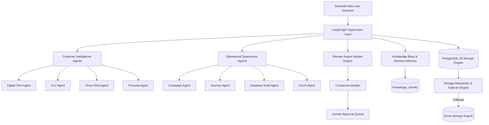
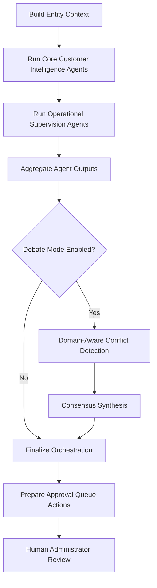
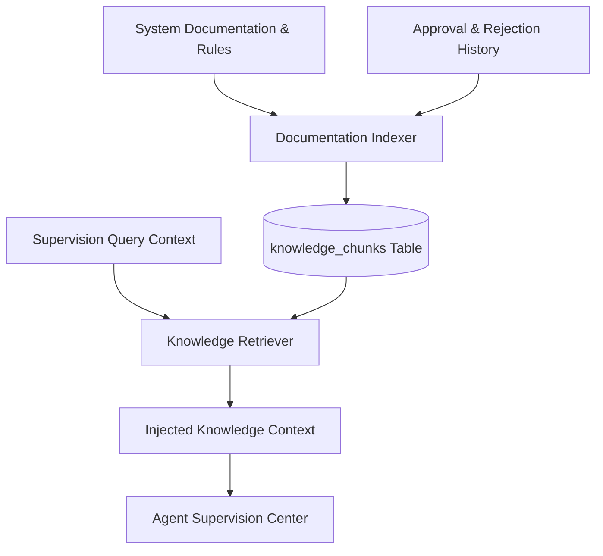
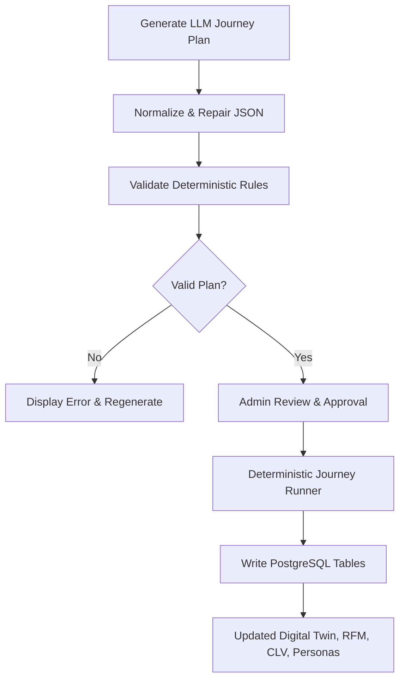

# OSMOS Technical Architecture Specification

This document provides a comprehensive architectural specification of the **OSMOS** (Omnichannel Supervised Marketing Optimization System) platform, detailing system components, data persistence, multi-agent supervision orchestrated via LangGraph, knowledge memory, and human-supervised governance.

---

## High-Level System Architecture

OSMOS is structured as a decoupled, multi-layered architecture designed for analytical precision, historical traceability, and operational safety.

---

## 1. LangGraph Multi-Agent Supervision Layer

OSMOS utilizes **LangGraph** as the primary stateful workflow engine for multi-agent supervision (`agents/langgraph_supervision/`).

### Architectural Characteristics:
- **Graph-Based Orchestration**: Wraps existing deterministic analytical agents as graph nodes without altering their internal calculation routines.
- **Stateful Execution**: Maintains a centralized `SupervisionState` context across graph node transitions.
- **Modular & Inspectable**: Each agent execution, conflict check, and consensus step is an explicit node in the graph graph topology.
- **Deterministic & Read-Only**: Agent nodes execute pure analytical logic with zero side effects or automated database mutations.
- **Fallback Compatibility**: The legacy `OrchestratorAgent` remains fully functional as a fallback mechanism.

### Supervision Graph Workflow Sequence:

---

## 2. Specialized Agent Definitions

Supervision is divided across 8 specialized agents categorized into two functional domains:

### A. Customer Intelligence Domain
1. **Digital Twin Agent (`digital_twin`)**: Evaluates profile completeness, identity validity, and behavioral metric consistency.
2. **CLV Agent (`clv`)**: Analyzes Customer Lifetime Value (CLV) monetary projections, value tiering (High/Medium/Low), and VIP value collapse risks.
3. **Churn Risk Agent (`churn`)**: Computes churn probability scores, friction signals, complaint occurrences, and inactivity windows.
4. **Persona Agent (`persona`)**: Verifies segment-first stable persona assignments and identifies unmapped customer segments.

### B. Operational Supervision Domain
5. **Campaign Agent (`campaign`)**: Audits campaign dispatches, dispatch gaps, and customer response alignments.
6. **Journey Agent (`journey`)**: Tracks Digital Twin lifecycle scenario stage progression and trigger event references.
7. **Database Audit Agent (`database_audit`)**: Monitors PostgreSQL table row counts, orphaned foreign key references, and storage mode status.
8. **UI/UX Agent (`ui_ux`)**: Assesses demonstration readiness, PII safety, and presentation suitability for executive review.

---

## 3. Domain-Aware Agent Debate Mode

The **Debate Engine** (`agents/debate_engine.py`, `agents/conflict_detector.py`) performs cross-agent position comparison using explicit domain boundaries to eliminate false contradictions.

### Domain Groupings:
- **Customer Intelligence Domain**: `{digital_twin, clv, churn, persona}`
- **Operational Supervision Domain**: `{campaign, journey, database_audit, ui_ux}`

### Disagreement Resolution Principles:
1. **CLV Status vs Churn Risk**: A `CLV Agent OK` status indicates that the CLV calculation model executed validly; it does **not** signify that the customer is healthy. Therefore, `CLV OK` vs `Churn Critical` is not treated as a domain status contradiction. When churn risk is `Critical` and CLV is `Low Value`, the debate engine synthesizes a specific finding: *"High churn risk with low CLV suggests low-cost automated retention/service recovery rather than expensive incentive."*
2. **Journey Status vs Churn Risk**: A `Journey Agent OK` status confirms lifecycle scenario structure integrity, not customer health. Cross-domain status differences between Journey and Churn do not trigger status conflicts.
3. **Database Audit Classification**: A Database Audit status of `Warning` when `orphaned_references == 0` is classified as a *"demo readiness / initialization warning"*. It is classified as a *"data integrity issue"* only when `orphaned_references > 0`, missing foreign key references exist, or table corruptions are detected.

### Consensus Status Classification:
- **`Strong Consensus`**: All active agents exhibit aligned findings with zero conflicts.
- **`Partial Consensus`**: Agents exhibit minor priority alignments or non-critical warnings.
- **`Conflict Detected`**: High-severity priority clashes exist between risk and opportunity agents.
- **`Critical Conflict`**: Critical database audit failures or critical risk overrides exist.
- **`Insufficient Data`**: Majority of agents lack sufficient data for analysis.

---

## 4. Knowledge Base & Decision Memory Architecture

OSMOS includes an internal RAG-driven **Knowledge Base** (`knowledge/`) providing documentation memory and historical decision traceability.

### Persistence Tables:
- **`knowledge_documents`**: Stores raw documentation files, governance rules, and system explanations.
- **`knowledge_chunks`**: Stores chunked text passages with metadata tags for keyword and vector-style search retrieval.

*Note*: The Knowledge Base does not replace analytical agents; it supplements them with historical context and organizational rules.

---

## 5. Controlled Journey Simulator & LLM Journey Planner

OSMOS provides a controlled **Journey Simulator** (`journey/`) for demonstrating customer lifecycle evolution on entity `P_DEMO_001`.

### Deterministic Safety Rules:
- The local LLM **only proposes** candidate journey plans. It never writes database records directly.
- Plans undergo strict deterministic validation (allowed event types, coherent timestamps, post-conversion purchases, persona resolvability).
- Plan quality is scored (Quality Labels: `Excellent`, `Acceptable`, `Weak`, `Invalid`).
- Execution occurs only after explicit administrator approval.

---

## 6. Executive Report Generator

The **Executive Report Generator** (`reports/`) aggregates system metrics, agent debate findings, and RAG knowledge evidence into structured reports exportable as **Markdown**, **HTML**, or standalone **PDF** files.

- **Report Types**: Entity Executive Report, Agent Run Report, Journey Report, System Overview Report.
- **Governance**: LLM executive summary generation remains button-triggered only.
