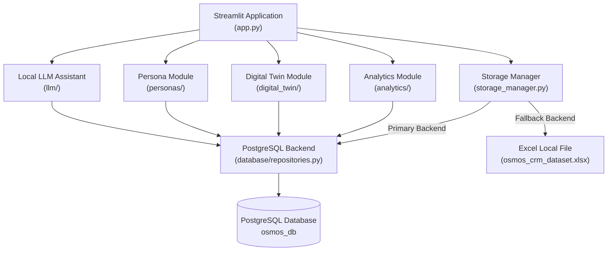

# OSMOS — Technical Architecture & Component Structure

## 1. System Overview

OSMOS is built using a modular Python architecture designed for scalability, low-latency event processing, and seamless switching between database backends.



---

## 2. Directory Structure & Key Modules

```
PFA-Summer/
├── app.py                          # Core Streamlit Web Application Interface
├── .env                            # Root Configuration (OSMOS_STORAGE_BACKEND=postgres)
│
├── storage/                        # Unified Storage Abstraction Layer
│   ├── storage_manager.py          # Backend routing logic & Excel fallback management
│   └── excel_storage.py            # Local Excel dataframe reader/writer
│
├── database/                       # PostgreSQL Persistence Engine
│   ├── db_connection.py            # Connection pool & lifecycle manager
│   ├── repositories.py             # SQL Repositories for entities, predictions, snapshots
│   └── schema.sql                  # DDL SQL Schema definitions
│
├── digital_twin/                   # Digital Twin Representation Layer
│   ├── digital_twin_builder.py     # Profile assembly & state vector synthesis
│   ├── digital_twin_explainer.py   # Deterministic explanations & LLM summary generators
│   └── digital_twin_dashboard.py   # Streamlit UI Explorer for Digital Twins
│
├── personas/                       # Persona Modeling & Library Catalog
│   ├── persona_library.py          # DB CRUD & in-memory persona definitions
│   ├── persona_matcher.py          # Segment-first persona resolution chain
│   ├── seed_persona_library.py     # Seeding blueprint definitions
│   └── persona_dashboard.py       # Streamlit UI Catalog for Personas
│
├── analytics/                      # Advanced Historical Intelligence
│   ├── clv_trends.py               # CLV trend & anomaly alert engine
│   ├── segment_transition.py       # Markov segment transition matrix generator
│   └── prediction_drift.py         # Dynamic classification drift detector
│
├── llm/                            # Local LLM Advisory Layer
│   ├── llm_client.py               # Ollama HTTP client interface
│   ├── llm_config.py               # LLM system prompts & configuration
│   └── llm_json_utils.py           # Robust JSON parsing & fallback utility
│
├── admin/                          # Database Intelligence & Monitoring
│   ├── database_dashboard.py       # Health, metrics, & table management UI
│   └── database_metrics.py         # System health, table sizes, & index metrics
│
└── docs/                           # System Documentation Package
```

---

## 3. Technology Stack

- **Frontend / UI**: Streamlit 1.30+
- **Backend / Logic**: Python 3.11+
- **Database**: PostgreSQL 15+ / psycopg2 connection pool
- **Data Processing**: Pandas, NumPy, Scikit-Learn
- **Local LLM Engine**: Ollama (Qwen3-8B / Llama 3.1 8B / Phi-4-mini)
- **Visualization**: Plotly Express, Plotly Graph Objects
