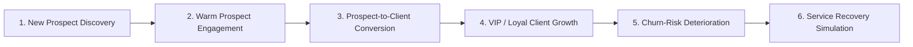
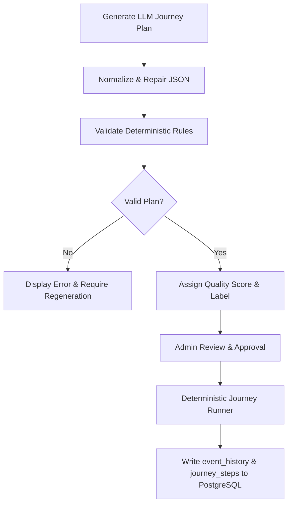

# OSMOS Journey Simulator & LLM Scenario Planner (Phases 7.5 - 8.7)

## Overview
The **Digital Twin Journey Tree Simulator** (`journey/`) serves as the controlled lifecycle scenario generator for OSMOS.

It enables administrators to simulate step-by-step customer lifecycle evolution on demo entity `P_DEMO_001`, generating real PostgreSQL history records to prepare the demo entity for Agent Supervision, Debate Mode, Campaign Simulation, Knowledge Base retrieval, Executive Reports, and executive presentation demonstrations.

---

## Controlled Lifecycle Progression (6 Stages)

### Registered Data Artifacts per Stage:
Every stage execution inserts permanent database records across 7 PostgreSQL tables:
- `event_history`: Real interaction and purchase transaction event rows.
- `journey_steps`: Stage transition tracking logs.
- `digital_twin_snapshots`: Versioned Digital Twin profile metrics.
- `rfm_es_scores`: Recalculated engagement and satisfaction scores.
- `clv_predictions`: Updated monetary CLV predictions.
- `classification_predictions`: Model lifecycle classification predictions.
- `customer_segments`: Updated segment and stable persona records.

*Note*: Journey events write real database history records—they are **not** transient UI-only values.

---

## LLM-Assisted Journey Scenario Planner

The **LLM Journey Scenario Planner** (`llm_journey_planner.py`) allows local LLMs to propose candidate multi-stage lifecycle plans.

### Deterministic Safety & Governance Controls:
1. **No Direct Writes**: Local LLM generates JSON proposals only. Zero direct SQL writes are executed by the LLM.
2. **Button-Triggered Only**: LLM plan generation occurs strictly upon user button click. Zero calls occur on page load or inside data retrieval functions.
3. **Validation Suite (`llm_journey_planner_validator.py`)**: Evaluates candidate plans against 10 strict checks:
   - Candidate `entity_id` must equal `P_DEMO_001`.
   - Event types must belong to authorized telemetry catalog.
   - Event timestamps must be chronologically non-decreasing.
   - Purchases permitted only post-conversion to `Client`.
   - VIP stage must contain high-value purchase telemetry ($>1,000$ MAD).
   - Churn stage must contain negative friction telemetry (`complaint`, `inactivity_period`).
   - Persona must resolve via `persona_library`.
   - Zero PII or unmapped fields.
4. **Quality Scoring**: Assigns quality scores ($0 - 100$) and labels (`Excellent`, `Acceptable`, `Weak`, `Invalid`). Invalid plans are blocked from execution.
5. **Admin Approval Mandate**: Administrator review and explicit approval are required before the deterministic `JourneyRunner` applies events to PostgreSQL.

---

## Module Files

- `journey_runner.py`: Deterministic execution engine for applying scenario stages.
- `journey_repository.py`: PostgreSQL persistence methods for journey scenarios and steps.
- `journey_tree.py`: Interactive Streamlit visualization component for lifecycle stage trees.
- `journey_dashboard.py`: Main dashboard interface for demo entity preparation and LLM scenario planning.
- `llm_journey_planner.py`: Ollama LLM prompt builder for candidate scenario generation.
- `llm_journey_planner_validator.py`: Deterministic 10-rule validator and quality scoring engine.
- `llm_json_utils.py`: Robust JSON extraction and syntax repair utilities.
