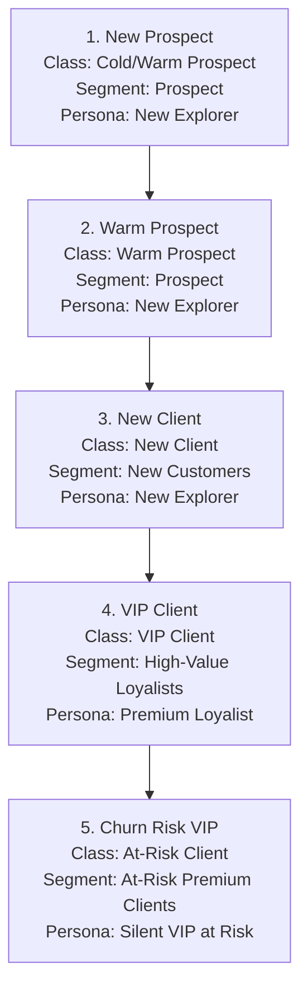

# OSMOS — Digital Twin Journey Tree Simulator (`journey/`)

## 1. Overview & Purpose

The **Digital Twin Journey Tree Simulator** (`journey/`) provides a guided demonstration scenario illustrating single-entity Digital Twin evolution through a full 5-stage customer lifecycle:

```
1. New Prospect ➔ 2. Warm Prospect ➔ 3. New Client ➔ 4. VIP Client ➔ 5. Churn Risk VIP
```

This feature allows administrators, researchers, and stakeholders to visualize how simulated customer events mutate an entity's Digital Twin state, trigger automated score recalculations (RFM-ES, CLV, Churn Risk), update dynamic lifecycle classification, transition customer segments, and resolve segment-first persona blueprints in real time.

---

## 2. Scientific Rationale & Segment-First Persona Resolution

> **Segment-First Resolution Rule**:
> `entity_id` ➔ `customer_segment` ➔ `persona_library.segment_name` ➔ `persona`

Unlike monolithic systems that assign static personas, OSMOS dynamically computes customer segments based on behavioral telemetry and machine learning predictions. The Digital Twin then looks up the corresponding persona blueprint from the 10-blueprint `persona_library` in PostgreSQL.



---

## 3. Demo Script & Presentation Guide

### 🎤 Speaker Script: "From New Prospect to VIP to Churn Risk"

> *"This scenario follows one entity (`P_DEMO_001`) through several simulated interactions. Each event modifies the entity's Digital Twin, triggers score and prediction updates, changes its segment and persona when necessary, and allows the local LLM to explain the business meaning of each transition."*

1. **Stage 1 (New Prospect)**: `P_DEMO_001` visits the web store and views a product page. The Digital Twin records exploratory telemetry (`recency_days = 30`, `visits_30d = 1`). Classification = `Cold Prospect`, Persona = `New Explorer`.
2. **Stage 2 (Warm Prospect)**: `P_DEMO_001` opens emails, clicks links, and adds an item to cart. Behavioral engagement increases, conversion probability rises to `Warm Prospect`.
3. **Stage 3 (New Client)**: `P_DEMO_001` completes their first purchase (`1,800 MAD`). Entity type converts from `Prospect` to `Client`. Segment transitions to `New Customers`.
4. **Stage 4 (VIP Client / Premium Loyalist)**: `P_DEMO_001` completes high-value repeat purchases (`8,500 MAD` + `12,000 MAD`) with positive reviews. CLV exceeds `20,000 MAD`, RFM score reaches `0.92`, segment shifts to `High-Value Loyalists`, and persona resolves to `Premium Loyalist`.
5. **Stage 5 (At-Risk Premium Client / Churn Risk)**: `P_DEMO_001` files a complaint, leaves a negative review, and remains inactive. Churn risk score increases to `0.65`, segment shifts to `At-Risk Premium Clients`, persona resolves to `Silent VIP at Risk`, and recommended action triggers a high-priority service recovery campaign.

---

## 4. Component Structure

| Module File | Purpose & Responsibilities |
| :--- | :--- |
| **[`journey_repository.py`](file:///D:/EMSI/PFA-Summer/journey/journey_repository.py)** | PostgreSQL repository for `journey_scenarios` and `journey_steps` tables. |
| **[`journey_scenarios.py`](file:///D:/EMSI/PFA-Summer/journey/journey_scenarios.py)** | 5-stage customer lifecycle scenario definitions and event triggers. |
| **[`journey_runner.py`](file:///D:/EMSI/PFA-Summer/journey/journey_runner.py)** | Execution engine for step-by-step or full journey runs with single-entity snapshot save. |
| **[`journey_tree.py`](file:///D:/EMSI/PFA-Summer/journey/journey_tree.py)** | Mermaid tree generator and HTML step card formatting. |
| **[`journey_dashboard.py`](file:///D:/EMSI/PFA-Summer/journey/journey_dashboard.py)** | Streamlit interface with tree view, timeline, entity snapshot, and Presentation Mode. |
| **[`test_journey.py`](file:///D:/EMSI/PFA-Summer/journey/test_journey.py)** | Unit test suite for scenario execution and Excel/PostgreSQL modes. |

---

## 5. Storage & LLM Principles

- **PostgreSQL Mode (`OSMOS_STORAGE_BACKEND=postgres`)**: Fully enabled. Scenarios, steps, events, and snapshot states persist in PostgreSQL.
- **Excel Fallback Mode**: Gracefully displays a message: *"Journey Simulator with historical tracking requires PostgreSQL."* The app remains 100% operational without crashing.
- **Single-Entity Save Optimization**: Execution updates ONLY `P_DEMO_001` (< 1s execution time, no full dataframe rewrite).
- **Button-Triggered LLM Calls**: LLM cognitive explanations are generated ONLY when the admin clicks **`🤖 Generate LLM Explanations`**. No automatic LLM calls occur on app startup.
