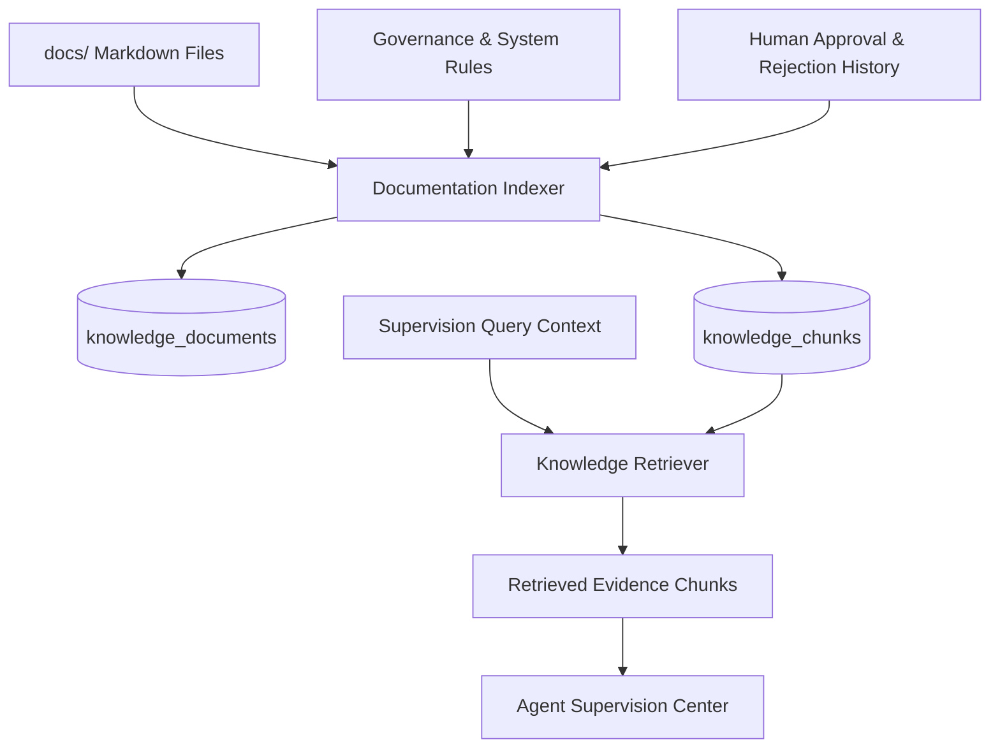

# OSMOS Knowledge Base & Decision Memory (Phase 8.5)

## Overview
The **Knowledge Base & Decision Memory** module (`knowledge/`) equips OSMOS with internal documentation memory and historical decision traceability.

It indexes system documentation, architectural guidelines, governance rules, and past human approval queue decisions into chunked text stores, enabling multi-agent supervision workflows to query historical context via Retrieval-Augmented Generation (RAG).

---

## Architectural Principles

> [!NOTE]  
> **Traceability Tool, Not Agent Replacement**: The Knowledge Base does **not** replace deterministic analytical agents. Instead, it supports agents by supplying traceable evidence and past organizational context during multi-agent evaluations.

---

## Knowledge Indexing & Retrieval Flow

---

## Database Tables

1. **`knowledge_documents`**: Stores document headers, titles, file paths, document types (`doc`, `rule`, `decision`), and index timestamps.
2. **`knowledge_chunks`**: Stores chunked text passages (with 500-character windows and 50-character overlaps) tagged with metadata for keyword and vector-style search retrieval.

---

## Knowledge Sources

- **System Documentation**: Markdown files in `docs/` (`OSMOS_Technical_Architecture.md`, `OSMOS_Scientific_Explanation.md`, etc.).
- **Governance Guidelines**: Safety rules, domain debate principles, and human approval mandates.
- **Decision Memory**: Historical items from `human_approval_queue` (approved recommendations, rejected proposals, converted campaign drafts).

---

## Module Components

- `documentation_indexer.py`: Scans `docs/` and approval tables, parses markdown structure, generates text chunks, and writes PostgreSQL records.
- `knowledge_retriever.py`: Executes similarity search over `knowledge_chunks` based on query context (entity state, segment, churn status).
- `knowledge_dashboard.py`: User interface for manual document re-indexing, chunk search, and memory inspection.
