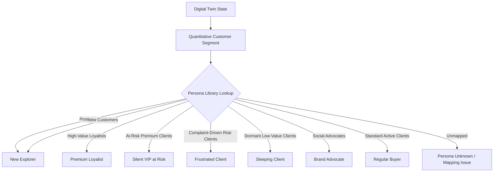

# OSMOS Persona Library & Dynamic Clustering (`personas/`)

## Overview
The **Persona Module** (`personas/`) manages customer behavioral profiling, segment-first persona assignments, and exploratory dynamic clustering.

OSMOS enforces a strict architectural distinction between **Stable Business Personas** and **Dynamic Analytical Clusters**.

---

## Stable Business Personas vs Dynamic Clusters

### Official Mapping Matrix:

- **Prospect** $\rightarrow$ `New Explorer`
- **New Customers** $\rightarrow$ `New Explorer`
- **High-Value Loyalists** $\rightarrow$ `Premium Loyalist`
- **At-Risk Premium Clients** $\rightarrow$ `Silent VIP at Risk`
- **Complaint-Driven Risk Clients** $\rightarrow$ `Frustrated Client`
- **Dormant Low-Value Clients** $\rightarrow$ `Sleeping Client`
- **Social Advocates** $\rightarrow$ `Brand Advocate`
- **Standard Active Clients** $\rightarrow$ `Regular Buyer`

---

## Key Governance Rules

- **Segment-First Resolution**: Official business personas are resolved deterministically from assigned customer segments via `persona_library`.
- **Persona Mapping Issue Detection**: If a customer entity is assigned a valid segment but `customer_persona` returns `None` or `Unknown`, the `PersonaAgent` flags a **Persona Mapping Issue** (`CONF_PERS_MAP_001`).
- **Dynamic Clustering**: Unsupervised K-Means clustering (`dynamic_persona_generator.py`) is provided for exploratory data science discovery; it does **not** override official stable persona mappings in `persona_library`.

---

## Module Files

- `persona_library.py`: Database seed and lookup routines for stable persona blueprints.
- `dynamic_persona_generator.py`: Unsupervised K-Means clustering for dynamic cohort analysis.
- `persona_dashboard.py`: Streamlit interface for viewing persona blueprints and dynamic cluster distribution charts.
