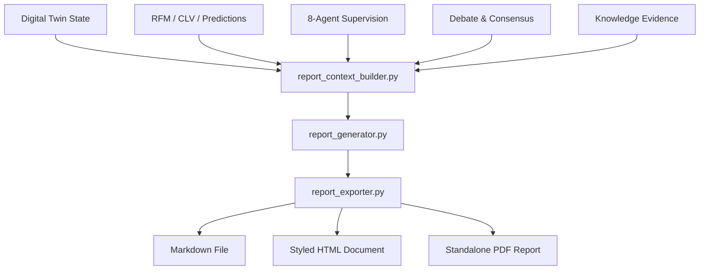

# OSMOS Executive Report Generator (Phase 8.6)

## Overview
The **Executive Report Generator** (`reports/`) compiles Digital Twin profile states, ML/RFM/CLV metrics, 8-agent supervision outputs, debate consensus decisions, RAG knowledge evidence, human approval history, campaign dispatches, and journey step traces into professional executive reports.

Reports are exportable in multiple formats: **Markdown** (`.md`), styled **HTML** (`.html`), and standalone **PDF** (`.pdf`).

---

## Report Compilation Flow

---

## Supported Report Types

1. **Entity Executive Report**: Deep-dive profile report for a single client or prospect entity (`P_DEMO_001`, etc.).
2. **Agent Run Report**: Audit document capturing the complete execution output of the 8 supervision agents.
3. **Journey Report**: Lifecycle scenario progression summary detailing step-by-step stage transitions.
4. **System Overview Report**: High-level platform health, active database metrics, and aggregate portfolio statistics.

---

## Governance & Safety Rules

- **Read-Only Operation**: Report compilation is 100% read-only with zero database state mutations.
- **Button-Triggered LLM Summaries**: Executive LLM summaries are strictly button-triggered ("LLM Executive Polish"). Zero automated background LLM calls occur during report generation.
- **Traceable Evidence**: All report findings link back to underlying database records, agent debate results, and knowledge memory passages.

---

## Module Components

- `report_schemas.py`: Dataclass structures (`ReportContext`, `ReportSection`, `ReportExportResult`).
- `report_context_builder.py`: Data assembly engine retrieving metrics from PostgreSQL tables.
- `report_templates.py`: Section renderers for Markdown and HTML styling.
- `report_generator.py`: Structured report compiler.
- `report_exporter.py`: Exporter handling file writing (Markdown, HTML) and PDF conversion via ReportLab / WeasyPrint.
- `report_dashboard.py`: Streamlit user interface for configuring, previewing, and downloading executive reports.
